<h1 align="center">
  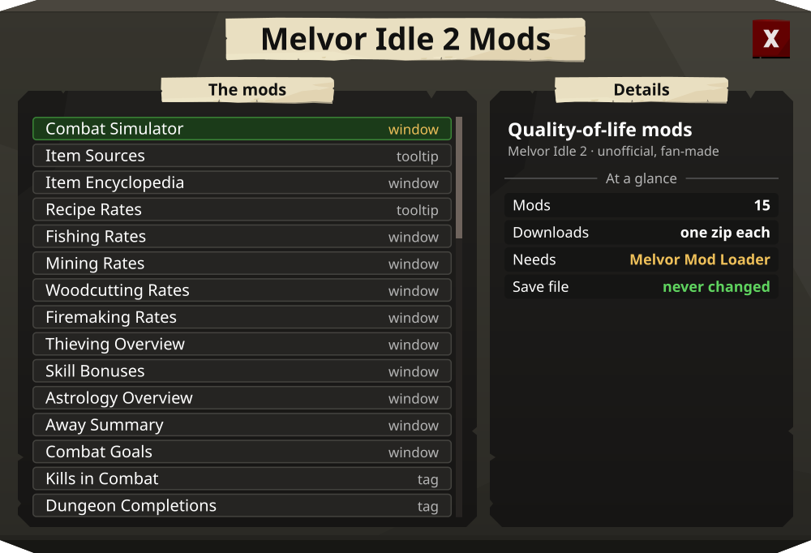
</h1>

<p align="center">
  
  
  
  <a href="LICENSE"></a>
</p>

<p align="center">
  <a href="https://github.com/Springs-Tea/melvor-idle-2-qol-mods/releases"></a>
  &nbsp;
  <a href="https://www.nexusmods.com/melvoridle2/mods/23"></a>
  &nbsp;
  <a href="https://www.nexusmods.com/melvoridle2/mods/2"></a>
</p>

<p align="center">
  <a href="#the-mods">The mods</a> ·
  <a href="#install">Install</a> ·
  <a href="#questions">Questions</a> ·
  <a href="#how-they-are-built">How they are built</a> ·
  <a href="#building-from-source">Building from source</a> ·
  <a href="#credits">Credits</a>
</p>

<p align="center">
  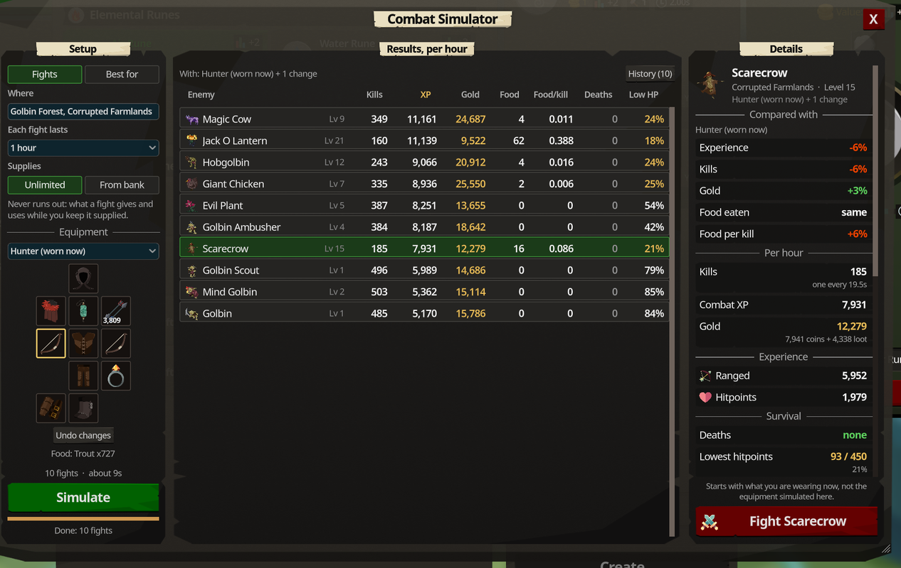
</p>

<h2 align="center"><a name="the-mods"></a></h2>

Take the ones you want. Each has a page of its own with pictures and details.

<table>
  <tr>
    <td width="330"><a href="mods/CombatSim">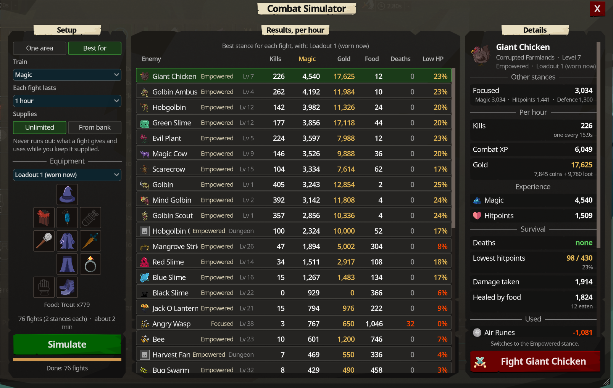</a></td>
    <td>
      <h3><a href="mods/CombatSim">Combat Simulator</a></h3>
      What an hour of each fight gives, uses and risks, worked out by running the game's own combat on a
      hidden copy of your character. Tick the areas to try, compare saved loadouts, items and spells,
      find the best place to train a skill, look at earlier scans again, then start the fight with one
      click.
      <br><a href="https://www.nexusmods.com/melvoridle2/mods/17">Also on Nexus Mods</a>
    </td>
  </tr>
  <tr>
    <td><a href="mods/ItemSources">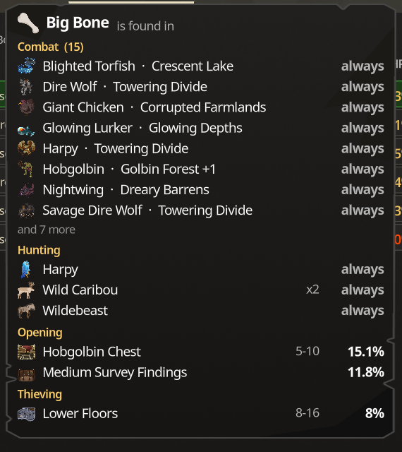</a></td>
    <td>
      <h3><a href="mods/ItemSources">Item Sources</a></h3>
      Hover "Found in" or "Used in" on an item: which enemy drops it and where it lives, how many and how
      likely, and every recipe, chest, thieving target or shop purchase that gives or uses it. Press Alt
      on any item's tooltip, anywhere in the game, to keep it open and do the same there.
      <br><a href="https://www.nexusmods.com/melvoridle2/mods/18">Also on Nexus Mods</a>
    </td>
  </tr>
  <tr>
    <td><a href="mods/ItemEncyclopedia">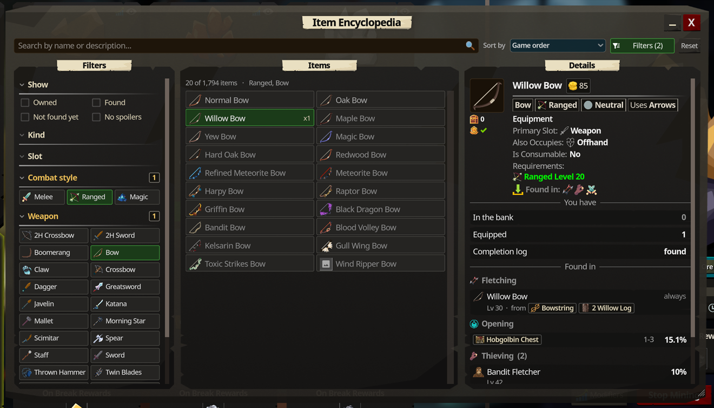</a></td>
    <td>
      <h3><a href="mods/ItemEncyclopedia">Item Encyclopedia</a></h3>
      Every item of the game in one window. Search it, filter it by kind, slot, combat style, weapon,
      skill and where it comes from, down to one dungeon, and read everything about an item: its stats
      and requirements, how many you have, which enemy drops it and how likely, what it is made from and
      what it is used in. Click an ingredient to go on from there.
      <br><a href="https://www.nexusmods.com/melvoridle2/mods/24">Also on Nexus Mods</a>
    </td>
  </tr>
  <tr>
    <td><a href="mods/RecipeRates">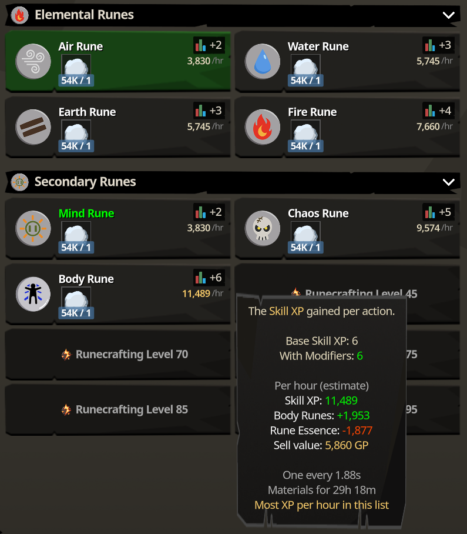</a></td>
    <td>
      <h3><a href="mods/RecipeRates">Recipe Rates</a></h3>
      XP per hour on every recipe of a skill's list, the best one in gold. In the XP tooltip the whole
      hour: XP, items made and used, what the products sell for, and how long your materials last.
      <br><a href="https://www.nexusmods.com/melvoridle2/mods/19">Also on Nexus Mods</a>
    </td>
  </tr>
  <tr>
    <td><a href="mods/SkillBonuses">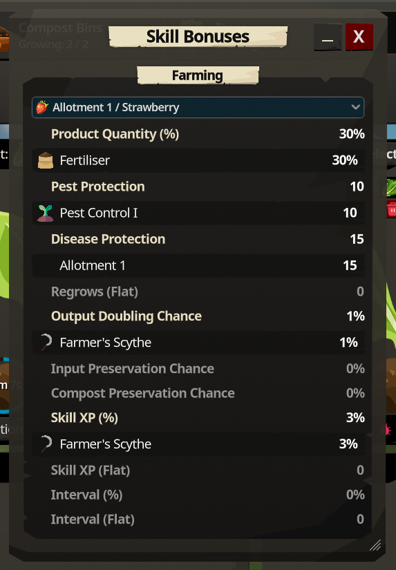</a></td>
    <td>
      <h3><a href="mods/SkillBonuses">Skill Bonuses</a></h3>
      A skill page shows the totals of its bonuses: the chance to double, the XP, the action time. A
      round button on the right opens a window with where each of them comes from: every item, pet, shop
      purchase, constellation and other source the game counts, the largest first, with what it gives.
    </td>
  </tr>
  <tr>
    <td><a href="mods/AstrologyOverview">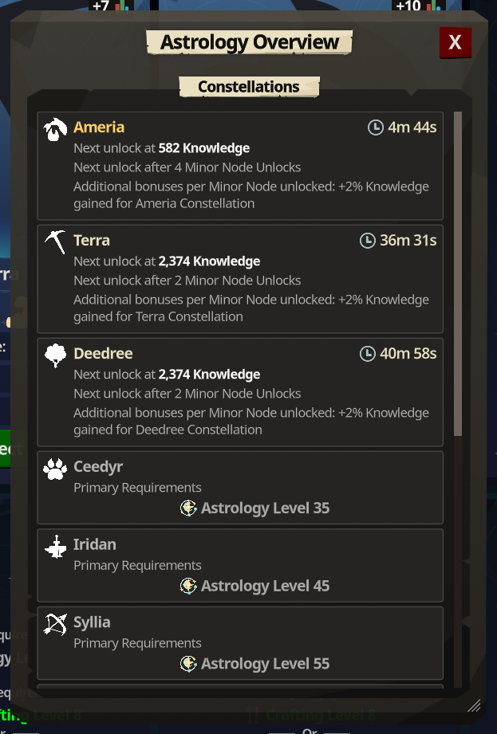</a></td>
    <td>
      <h3><a href="mods/AstrologyOverview">Astrology Overview</a></h3>
      Your constellations in one window, from a round button on the Astrology page: those with a node
      choice ready first, then the shortest study time to the next unlock. Under each name the knowledge
      of that unlock, the minor nodes the next major node needs and the bonus every minor node gives; a
      locked one shows only what it still misses. Click a row to look at that constellation.
    </td>
  </tr>
  <tr>
    <td><a href="mods/AwaySummary">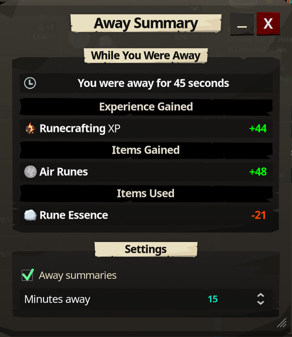</a></td>
    <td>
      <h3><a href="mods/AwaySummary">Away Summary</a></h3>
      Switch to another app or minimise the game while your character trains, and come back to a window
      with how long you were away and what changed, under the headings of the game's own summary: XP and
      levels, items gained and used, gold, and when an action stopped or a defeat cost you something. A
      round button on the right opens the last summary again.
    </td>
  </tr>
  <tr>
    <td><a href="mods/CombatGoals">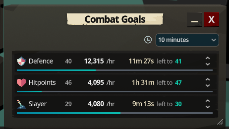</a></td>
    <td>
      <h3><a href="mods/CombatGoals">Combat Goals</a></h3>
      Combat trains several skills at once; the game's footer shows a level goal for one. A small
      draggable, resizable window with the XP per hour of each and the time left to a goal you set.
      <br><a href="https://www.nexusmods.com/melvoridle2/mods/20">Also on Nexus Mods</a>
    </td>
  </tr>
  <tr>
    <td><a href="mods/KillsInCombat">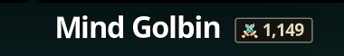</a></td>
    <td>
      <h3><a href="mods/KillsInCombat">Kills in Combat</a></h3>
      The number of times you have killed the enemy you are fighting, next to its name.
      <br><a href="https://www.nexusmods.com/melvoridle2/mods/21">Also on Nexus Mods</a>
    </td>
  </tr>
  <tr>
    <td align="center"><i>same small tag,<br>on every dungeon</i></td>
    <td>
      <h3><a href="mods/DungeonCompletions">Dungeon Completions</a></h3>
      The number of times you have completed each dungeon, in the combat areas menu.
      <br><a href="https://www.nexusmods.com/melvoridle2/mods/22">Also on Nexus Mods</a>
    </td>
  </tr>
</table>

Downloads are on this repository's [Releases](https://github.com/Springs-Tea/melvor-idle-2-qol-mods/releases).
If you would rather use Nexus Mods, the mods have pages
there too, with the same guide and the same zip, and there is one for
[all of them in one zip](https://www.nexusmods.com/melvoridle2/mods/23).

<h2 align="center"><a name="install"></a></h2>

The mods run on the unofficial [Melvor Mod Loader](https://www.nexusmods.com/melvoridle2/mods/2). Everything
is a plain zip that you extract into the game folder: no installer, nothing outside that folder.

1. **Open the game folder**: Steam > right-click Melvor Idle 2 > Manage > Browse local files.
2. **Install the loader**: extract its zip there. `override.cfg` ends up next to `Melvor2.exe`.
3. **Add the mods you want**: extract each zip from [Releases](https://github.com/Springs-Tea/melvor-idle-2-qol-mods/releases) into the same folder. `MelvorIdle2-QoL-Mods-<version>.zip` is all of them in one. The same zips are on [Nexus Mods](https://www.nexusmods.com/melvoridle2/mods/23), if you prefer to get them there.
4. **Start the game** from Steam. A green line in the top left corner says how many mods were loaded.

```
Melvor Idle 2\
├─ Melvor2.exe
├─ override.cfg                                   the loader
├─ data_MelvorModLoader_windows_x86_64\           the loader
└─ mods\
   ├─ CombatSim\CombatSim.dll
   ├─ ItemSources\ItemSources.dll
   └─ ...                                         one folder per mod
```

**To remove a mod**, delete its folder under `mods`. Its settings (a window's place and size, your level
goals) are in that folder too, so nothing is left behind.

<h2 align="center"><a name="questions"></a></h2>

<details>
<summary><b>Is my save safe?</b></summary>

Yes. No mod changes what is in your save, and none adds or removes anything in the game. The Combat
Simulator asks the game to save the way its autosave does, reads that file, and works on a copy of the
character that exists only in memory and is thrown away after every fight. The one button that acts on the
game, "Fight", does what the game's own area menu does: it starts a fight.
</details>

<details>
<summary><b>Do they make the game easier?</b></summary>

They show information the game already has (drop tables, recipe values, statistics) or works out the same
way (the simulator runs the game's own combat). They give no items, XP or bonuses.
</details>

<details>
<summary><b>What happens after a game update?</b></summary>

The game is in early access and the loader is unofficial, so an update can break a mod until it is rebuilt.
A mod that cannot find what it needs stops itself and says so in `MelvorModLoader.log`; the game and the
other mods keep running. If the game does not start at all, delete `override.cfg` to play without mods.
</details>

<details>
<summary><b>Something is wrong. What do you need?</b></summary>

Open an [issue](https://github.com/Springs-Tea/melvor-idle-2-qol-mods/issues) with the mod's name, the game version, and `MelvorModLoader.log` from the
game folder (it is rewritten on every start).
</details>

<p align="center">
  <a href="https://github.com/Springs-Tea/melvor-idle-2-qol-mods/issues"></a>
</p>

<h2 align="center"><a name="how-they-are-built"></a></h2>

Every mod is a small C# class library that runs inside the game, compiled against the game's own assembly.

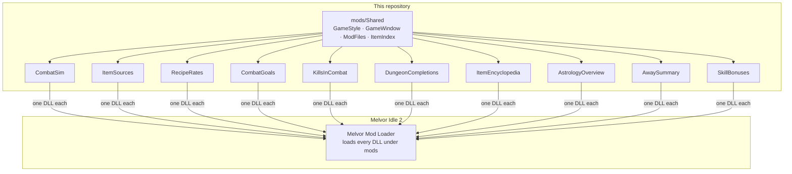

- **They look like the game because they use the game.** `mods/Shared/GameStyle.cs` loads the game's own
  textures, fonts and colours at runtime; nothing is copied into a mod. `GameWindow.cs` is a draggable,
  resizable window in the style of the game's pop-ups.
- **They read the game instead of re-creating it.** The simulator runs the game's combat; Item Sources and
  the Item Encyclopedia read the game's drop tables and recipes through one shared index; Recipe Rates uses
  the game's own values for a recipe, bonuses included.

| Folder | Contents |
| --- | --- |
| `mods/<Mod>` | One project per mod: its code, a `README.md` for people and the `README.txt` that ships in the zip. |
| `mods/Shared` | The game's look and a few helpers, compiled into every mod. |
| `mods/Directory.Build.props` | What every mod's build has in common, and the one version they share. |
| `third_party/MelvorModLoader` | The loader's source (MIT, by falorfrozen), to read: it is the API the mods are written against. |
| `publish` | The release checklist and the page texts for Nexus Mods. |
| `tools` | Scripts for building, packaging and looking around the game while developing. |
| `docs/img` | The pictures on these pages. |

<h2 align="center"><a name="building-from-source"></a></h2>

You need the game with the loader installed, the [.NET 10 SDK](https://dotnet.microsoft.com/download), and
PowerShell 7 for the scripts. The projects compile against the game's DLLs where the game is installed. When
that is not the usual Steam folder (`C:\Program Files (x86)\Steam\steamapps\common\Melvor Idle 2`), copy
`Local.props.example` to `Local.props` and put your folder there; the builds and the scripts both read it.

```powershell
# one mod, straight into the game's mods folder (close the game first: the DLL is locked while it runs)
dotnet build mods\RecipeRates\RecipeRates.csproj -c Release

# every mod as a release zip in dist\ (the game may stay open)
.\tools\package.ps1
```

Want to change something or add a mod? See [CONTRIBUTING.md](CONTRIBUTING.md); a coding agent starts at
[AGENTS.md](AGENTS.md). What changed between
releases is in the [changelog](CHANGELOG.md), and what the mods do and do not do on your computer is in
[SECURITY.md](SECURITY.md).

<h2 align="center"><a name="credits"></a></h2>

- [Melvor Mod Loader](https://github.com/falorfrozen-cmd/MelvorModLoader) by falorfrozen makes mods for this
  game possible. Its wiki is where to start if you want to write one.
- Melvor Idle 2 is made by Games by Malcs and published by Jagex. This project is unofficial and fan-made,
  and is not affiliated with either. No game files are in this repository.

The code is under the [MIT license](LICENSE).
