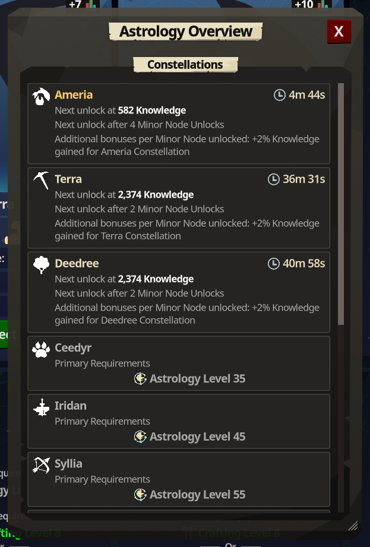

<h1 align="center"></h1>

  
  &nbsp;
  

> Which constellation is closest to its next unlock?

Open **Astrology** and press the round button with the star in the strip of round buttons on the right edge
of the screen, where the game has its own tool belt and events buttons. The button is there only on the
Astrology page, and it is lit while the overview is open. You can open the overview from the list of
constellations or while looking at one of them.

## Reading the list

- Constellations with a minor or major node choice ready come first, with their names in gold. Their row
  says how many nodes are available to unlock, in the words of the game's constellation screen.
- Then come the others, the shortest study time first. The time is on the right of the name. When no
  choice is ready, the name with the shortest time is in gold, and so are any with the same time.
- Under the name: the knowledge of the next unlock as the constellation screen shows it ("Next unlock at
  ... Knowledge"), how many more minor nodes the next major node needs, and the bonus every minor node gives.
- A locked constellation shows only the requirements it still misses, in the game's own requirement view.
  Constellations the game has not revealed yet are not listed. Finished constellations come last.

The time counts whole studies at your current knowledge per study and study interval. For the
constellation you are studying, it counts the time left on the current study. Random events and time
spent meeting other requirements are left out.

Click a row to look at that constellation in the game: it is the same as clicking its card in the game's
list. The overview closes, so you see the constellation. A locked row does not light up under the pointer
and cannot be clicked. The red **X** or the round button closes the overview too.

Drag the window from any empty spot. Drag the lines in its bottom right corner to make it larger or
smaller. It stays above the game's bar along the bottom of the screen, and is never larger than the room
above that bar.

## Good to know

- The mod has no settings and writes no files. The window's place and size are kept until you close the
  game.
- Opening a row cannot start, stop or switch a study, spend a node choice or change your save.

## When something is off

| You see | What to check |
| --- | --- |
| No round button with the star | Open Astrology and look in the strip on the right edge. If it is still missing, look for a line starting with `[AstrologyOverview]` in `MelvorModLoader.log`. |
| A next unlock without a time | The game needs a positive knowledge per study and study interval to give an estimate. |
| A row and the game's constellation screen disagree | Include the constellation name and a picture of each screen when reporting it. |

## Install

1. Install the [Melvor Mod Loader](https://www.nexusmods.com/melvoridle2/mods/2) (0.1.3 or newer).
2. In Steam, right-click Melvor Idle 2 and choose **Manage > Browse local files**.
3. Extract the zip there. The file should be at `mods\AstrologyOverview\AstrologyOverview.dll`.
4. Start the game. `MelvorModLoader.log` in the game folder has a line `Mod loaded: AstrologyOverview`.

To update, extract the new zip over the old one. To remove the mod, delete `mods\AstrologyOverview`.
Your save is never changed.
