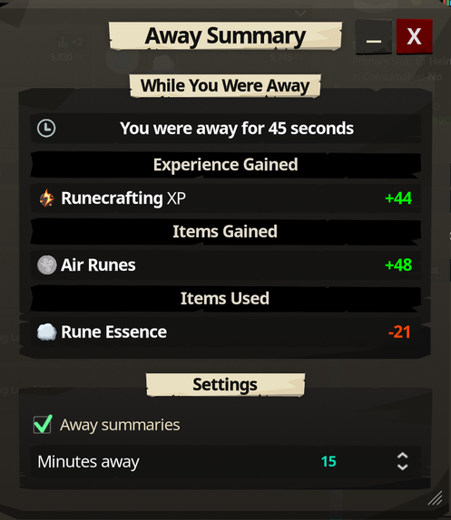

<h1 align="center"></h1>

  
  &nbsp;
  

> What changed while I was away?

Leave your character training and switch to another app, or minimise the game. Come back after **15 minutes**
and a window shows how long you were away and what changed.

## Reading the summary

The changes are listed under the same headings as in the game's own summary after a restart.

- Skills appear in the game's order, with the XP and levels you gained.
- Items show what entered and left your bank. An item can appear under both gains and uses.
- Arrows and other items used up from your equipment or a tool belt have headings of their own, as in the
  game's summary.
- Gold shows the difference between what you had when you left and when you returned.
- Stops and defeats come last. A stop shows the game's reason and how long after you left it happened. A
  defeat names the item and quantity you lost when the game reports a loss.

Only changes appear. If nothing happened, the summary just shows the time away.

## Opening it again

Click the round **Away Summary** button on the right to see the last summary for this character. Drag the
window to move it, drag its bottom right corner to resize it, or fold it down with the button beside the X.
Long lists scroll. Your window size, position and fold are kept for next time.

The same button opens **Settings** before your first summary. Set **Minutes away** to a whole number from
1 to 1,440 (one day). Clear **Away summaries** to stop collecting and showing new summaries. The button still
opens the last one.

## Good to know

- A shorter absence keeps the last summary. Changing characters or restarting clears it.
- When the game itself catches up, after a restart or after the computer slept, it shows its own
  **Welcome Back!** window. Away Summary skips that absence.
- The summary covers skill XP and levels, bank items, items used up from your equipment and tool belts, and
  gold. Mastery XP and other currencies are not counted.
- Settings are kept in `mods\AwaySummary\settings.json`. Your character's save is never changed.

## When something is off

If a summary never opens, check **Away summaries** and **Minutes away** with the round button. If the game
updated, look for `[AwaySummary] Stopped` in `MelvorModLoader.log` in the game folder. That line says what
changed. If something looks wrong, include a screenshot when reporting it.

## Install

1. Install the [Melvor Mod Loader](https://www.nexusmods.com/melvoridle2/mods/2) (0.1.3 or newer).
2. In Steam, right-click Melvor Idle 2 and choose **Manage > Browse local files**.
3. Extract the mod's zip there so the DLL is at `mods\AwaySummary\AwaySummary.dll`.
4. Start the game and look for `Mod loaded: AwaySummary` in `MelvorModLoader.log`.

To update, extract the new zip over the old one. To remove the mod and its settings, delete
`mods\AwaySummary`.
