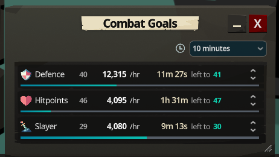

<h1 align="center"></h1>

<a href="../../README.md">All mods</a> · <a href="https://github.com/Springs-Tea/melvor-2-mods/releases">Download</a>

> How long until Magic 20, while I am also training Hitpoints and Defence?

The game's footer tells you how long a skill takes to reach a level goal, but only for one skill. Combat
trains several at once.

## What it does

- Lists every combat skill that is **gaining XP right now**, with its XP per hour and the time left to a
  level goal.
- Type a **goal level** per skill. Goals are remembered per character; a goal that is reached moves on to
  the next level.
- The rate is the average of the **current fight** over the last 1, 5, 10 or 30 minutes. Leaving combat,
  or fighting something else, starts the measurement again, so time spent on other skills never drags the
  rate down.
- The thin bar under each skill shows how far you are towards the goal.

## Using it

| | |
| --- | --- |
| Show / hide | The round button on the right edge of the screen (it appears while you fight), or **F10** |
| Move | Drag the window from any empty spot |
| Resize | Drag its bottom right corner; text and icons are redrawn sharp at the new size |

Outside combat the window hides by itself.

## Good to know

- The first ten seconds of a fight show nothing: a rate needs a little history.
- XP gained while the game was closed is not part of the rate.

## Install

1. Install the [Melvor Mod Loader](https://www.nexusmods.com/melvoridle2/mods/2).
2. Extract the mod's zip into the game folder, so the file ends up as `mods\CombatGoals\CombatGoals.dll`.

To remove it, delete `mods\CombatGoals` (your goals and the window's place are in `settings.json` there).
Your save is never changed.
