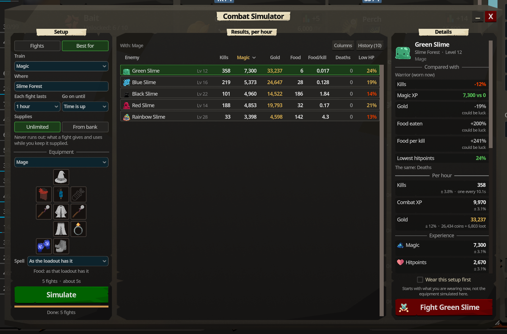
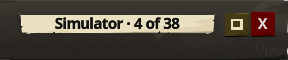
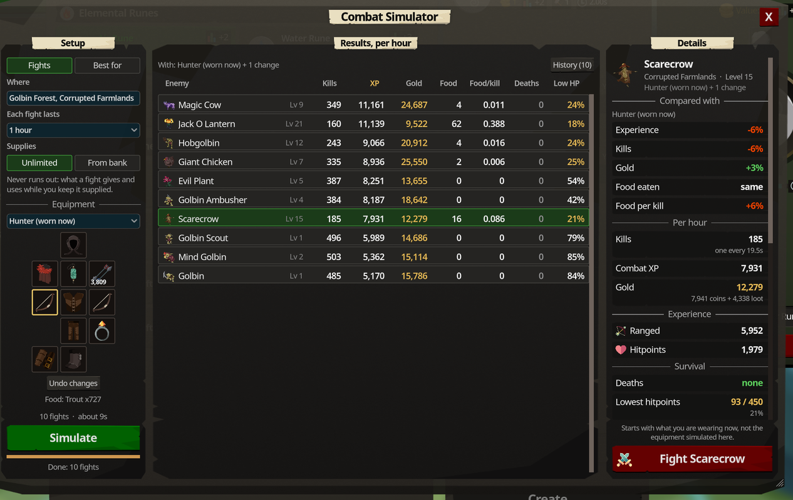
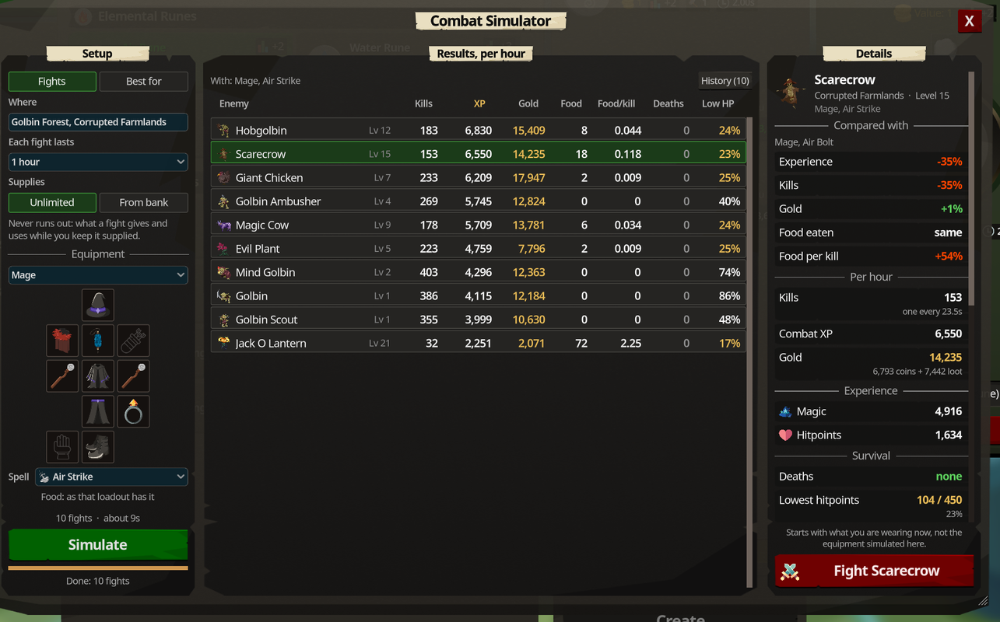
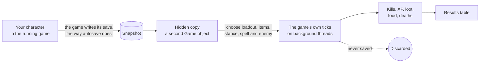

<h1 align="center"></h1>

  
  &nbsp;
  
  &nbsp;
  

> What does an hour of this fight give me, what does it cost, and will I die?

The Combat Simulator answers that without fighting. You choose where, for how long and with what; it runs
the fights and shows, for every one of them, an hour's kills, XP, gold, food and deaths.

It does **not** re-create the game's combat formulas. It loads a copy of your character into a second,
hidden game and runs the game's own combat on it. Nothing the copy does is ever saved.

## Contents

- [Opening it](#opening-it)
- [A first simulation, step by step](#a-first-simulation-step-by-step)
- [Reading the results](#reading-the-results)
- [Choosing where](#choosing-where)
- [Trying other equipment and spells](#trying-other-equipment-and-spells)
- [Finding where to train: "Best for"](#finding-where-to-train-best-for)
- [Supplies: unlimited or from the bank](#supplies-unlimited-or-from-the-bank)
- [Earlier scans](#earlier-scans)
- [The Fight button](#the-fight-button)
- [Questions it answers](#questions-it-answers)
- [How it works](#how-it-works)
- [How far to trust the numbers](#how-far-to-trust-the-numbers)
- [Settings and files](#settings-and-files)
- [When something is off](#when-something-is-off)

## Opening it

A round button with a chart on it sits in the strip of round buttons on the right edge of the screen. It
opens and closes the window. The window can be dragged from any empty spot and resized from its bottom
right corner; it remembers its place and size. It stays above the game's bar along the bottom of the screen,
and is never larger than the room above that bar.

Click the button beside the red X to fold the window down to its title. Until you run a scan after loading
your character, it says **Combat Simulator**. During a scan it counts the finished fights,
**Simulator · 4 of 12**, and at the end it says **Simulator · Done: 12 fights**. A scan you cancel says
**Simulator · Stopped: 4 of 12**. **Simulator · Error** means the window has a message for you: open it to
read it.

Click the fold button again or the round chart button to return to the same tab, list, sort order and
selected fight. The red X closes the window even when folded. A scan keeps running while the window is
folded or closed. If you close it folded, it opens folded next time.

The window has three columns: **Setup** on the left (what to simulate), **Results, per hour** in the middle
(one line per fight) and **Details** on the right (everything about the line you clicked).

## A first simulation, step by step

1. **Fights** is selected at the top of Setup. Leave it.
2. **Where**: click it and tick an area, for example the one you are fighting in. Close the list with Done.
3. **Each fight lasts**: 1 hour is a good start. This is game time, not waiting time: an hour of fighting
   takes about a quarter of a second to simulate.
4. **Supplies**: leave it on Unlimited.
5. **Equipment** shows what you are wearing. Leave it.
6. Press **Simulate**. The line under the button says how many fights that is and about how long it takes.
   The button turns into Cancel while it runs.
7. The lines appear in the middle as they finish, best XP first. Click one to see its details.

## Reading the results

Every number is **per hour of game time**, whatever length you simulated.

| Column | What it is |
| --- | --- |
| **Kills** | Enemies killed per hour. |
| **XP** | Combat XP per hour, all skills together. In "Best for" it is the XP of the skill you chose, and the column is named after it. |
| **Gold** | Coins dropped plus what the dropped items sell for. |
| **Food** | Pieces of food eaten per hour. |
| **Food/kill** | Pieces of food eaten per kill: the fight where your food lasts longest has the smallest number. The first click on it sorts the smallest to the top. A fight without a kill shows `-`. |
| **Deaths** | Times you die per hour. Grey 0 is what you want; anything else is red. The first click on it sorts the fewest to the top. |
| **Low HP** | The lowest your hitpoints got, as a share of the maximum. Gold under 35%, red under 15% or when you died. |

Click a column's name to sort by it, again to turn the order around. Fights with the same number, like all
those that eat no food, stand with the better XP first. `Lv 12` next to a name is the enemy's combat level;
a dungeon says `Dungeon` and is simulated as a whole, run after run.

The **Details** of a line, from top to bottom:

- **Compared with**: only when the same fight was simulated with other equipment or another spell. Each
  other setup gets lines for Experience, Kills, Gold, Food eaten and Food per kill saying how much better or
  worse *this* setup is. Green is better; for food, less is better.
- **Per hour**: kills (and how long one takes), dungeon runs, combat XP, and gold split into coins and loot.
- **Experience**: XP per hour for each skill that gained any.
- **Survival**: deaths and when the first one came, the lowest hitpoints, damage taken, and how much of it
  food healed. Then **Food per kill** (also as "one piece every 12 kills") and **Healed per kill**, and
  **Your food lasts**: how many kills the food in your bank is enough for in this fight. That is worked out
  from the food per kill, for the loadout you are wearing; when a From bank fight ate the last piece, it is
  the number of kills it had counted by then, in red.
- **Used**: what the fight consumed per hour: food, runes, arrows, prayer points.
- **Loot**: every item dropped per hour, with what it sells for.

A gold line of text under the name is a note from the run: an item that could not be equipped, a fight that
ended early because something ran out.

## Choosing where

"Where" opens the list of everything you have unlocked. Tick one area, several, a whole category by clicking
its heading, or nothing at all for everything. There is a search box. The line at the bottom counts the
fights you have ticked: an area is one fight per enemy in it, a dungeon is one fight.

"Fights" and "Best for" each remember their own choice of areas.

## Trying other equipment and spells

**Loadouts.** The box under Equipment lists your saved loadouts. Simulate a fight with one, switch to
another, simulate again: Details compares the two.

**Single items.** Click any slot to open every item of the game that fits it, the ones you own first. Type
to search; "Only items I own" hides the rest. A slot you changed gets a gold frame, and "Undo changes"
brings the loadout's own items back. An item you do not own is handed to the copy so you can see what it
would do; an item whose requirements you do not meet cannot be equipped by the copy either, and the result
says so.

  
  &nbsp;
  

**Spells.** When the weapon of the setup casts spells, a "Spell" box appears under the slots with the spells
that weapon can cast. Choosing one makes it a setup of its own, so two spells are compared the same way two
weapons are.

## Finding where to train: "Best for"

"Fights" answers "what do these fights give". **Best for** answers "where should I go". Choose the skill you
want to train (or all combat XP) and where to look. Every fight is run once in each attack stance of your
weapon, because the stance decides which skills get the XP, and each line shows the stance that trains your
skill best. The other stances of a fight are listed in its Details. A weapon with a single stance is simply
run once.

A scan of everything is many fights: the line above Simulate tells you how many and how long before you
start. Tick fewer areas to keep it short.

## Supplies: unlimited or from the bank

- **Unlimited** hands food, runes, arrows and prayer points back as they are used. These are the rates of a
  fight that is kept supplied: use it to compare places, equipment and spells.
- **From bank** uses what you own right now. Use it with a long duration to see how far your supplies get
  you: the note on the result says what ran out and when. Without arrows or runes the fight ends there.
  After the food runs out, the fight continues until the time is up or you die ten times in a row without a
  kill. If it ends early, the note says why and the rates cover the time fought. "Your food lasts" in the
  details says how many kills the food was enough for.

Either way, "Used" in the details tells you what an hour costs.

## Earlier scans

Every simulation you run is kept: the last ten for each character, also after the game was closed.
**History** lists them with what was asked and what came out on top. A click shows that scan again, table
and details, without simulating anything. While nothing has been simulated yet, the newest three are offered
right in the empty table.

The numbers of an earlier scan are from then: your levels and equipment may have changed since. A gold line
says so while one is on show, and "Back to now" leaves it.

## The Fight button

The red button under the details starts the selected fight in the game, the way the game's own area menu
does, and closes the window. The small text above it says exactly what else it will do: switch to the stance
of that result, and select the spell when the result was simulated with what you are wearing. It never
changes your equipment: if you simulated other items, you still have to put them on.

## Questions it answers

- **Where do I train Ranged fastest?** Best for > Ranged > Simulate. The top line is the place, and names
  the stance.
- **Is this weapon worth buying?** Simulate your area, click the weapon slot, pick the weapon (you do not
  have to own it), simulate again, read "Compared with".
- **Can I leave this running overnight?** From bank, 12 hours. No deaths, and no "Ran out of" or "Stopped
  at" note, means yes. Low HP tells you how close it was.
- **Which fight makes my food last longest?** Click Food/kill: the top line eats the least for each kill.
  "Your food lasts" in its details says how many kills the food in your bank is enough for.
- **Which spell?** Simulate once per spell and compare.
- **Where is the gold?** Simulate everything and sort by Gold.

## How it works

- Every fight starts from a **fresh copy** of the same snapshot, so one result cannot leak into the next.
- Loading a copy takes about a second, an hour of fighting about a quarter of one. Up to four fights run
  side by side, leaving half of your processor to the game you are playing: thirty-eight fights of an hour
  each take about half a minute.
- Because it is the game's combat, everything the game does is in the numbers as it is set when you press
  Simulate: your levels and bonuses, active prayers and potions, auto eat, special attacks, the enemy's
  passives.
- A copy is let go completely when its fight is over, so a long scan does not fill the memory.

## How far to trust the numbers

Fights are random. Two runs of the same fight differ by a few percent; the longer the fight, the steadier
the numbers. Use an hour or more before you decide anything on a difference of a few percent.

The simulator was compared with the real game once: 4,188 XP per hour simulated against 4,125 on the game's
own ten minute average for the same fight. That is one point, not a proof. Tell us when you see it off.

## Settings and files

Everything is in `mods\CombatSim`:

- `settings.json`: the window's place, size and folded state, and your last choices. `"Workers"` sets how
  many fights run side by side, 1 to 8 (0 lets the mod choose: half of the processor, four at most).
  Lower it if the game stutters during a scan.
- `history\<character>\`: the earlier scans. Delete the folder, or press Clear in History, to forget them.

## When something is off

| You see | What it means |
| --- | --- |
| A fight is missing from the table after Cancel | A fight that was cut short is dropped; the finished ones are kept. |
| "... could not be equipped (requirements not met?)" | The copy follows the game's rules: you do not meet that item's requirements. |
| "Ran out of ... after ..." | From bank: that supply was used up. Without arrows or runes the fight ended there; without food it went on. |
| "Stopped at ... after 10 deaths without food or a kill" | From bank: the food was gone and you died ten times in a row without killing anything. The fight ended there; the numbers are of the time until then. |
| "The fight could not be started" | The game refused to start it for the copy, usually an unmet requirement of the area. |
| "The game did not write a fresh save to simulate from" | The snapshot could not be taken. Try again; if it stays, report it with the log. |
| "This game version loads saves differently" or "copies are not being released" | A game update changed something the simulator depends on. It needs an update; the rest of the game is unaffected. |

## Install

Get the zip from <a href="https://github.com/Springs-Tea/melvor-idle-2-qol-mods/releases">Releases</a>, or from <a href="https://www.nexusmods.com/melvoridle2/mods/17">the mod's page on Nexus Mods</a> if you prefer.

1. Install the [Melvor Mod Loader](https://www.nexusmods.com/melvoridle2/mods/2) (0.1.3 or newer).
2. Open the game folder: Steam > right-click Melvor Idle 2 > Manage > Browse local files.
3. Extract the mod's zip there, so the file ends up as `mods\CombatSim\CombatSim.dll`.
4. Start the game. `MelvorModLoader.log` in the game folder has a line `Mod loaded: CombatSim`.

To update, extract the new zip over the old one. To remove the mod, delete `mods\CombatSim`. Its settings and earlier scans are in that folder too.
Your save is never changed.
