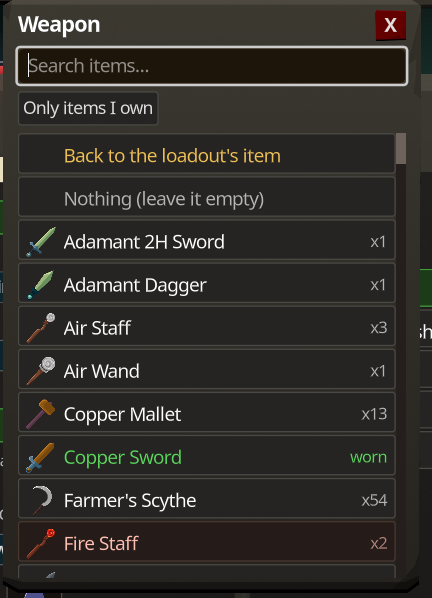
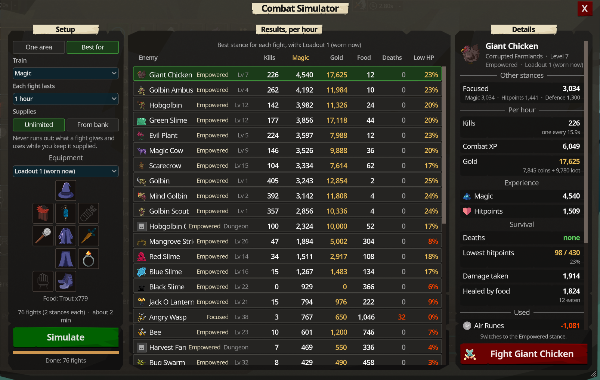
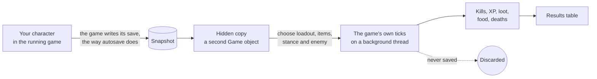

<h1 align="center"></h1>

<a href="../../README.md">All mods</a> · <a href="https://github.com/Springs-Tea/melvor-2-mods/releases">Download</a>

> What does an hour of this fight give me, what does it cost, and will I die?

## What it does

| | |
| --- | --- |
| **Simulate** | An area (every enemy in it), a dungeon, or everything you have unlocked, for 15 minutes to 12 hours of game time per fight. |
| **Results, per hour** | Kills, combat XP, gold, food eaten, deaths, and the lowest your hitpoints got. Click a column to sort. |
| **Details** | XP per skill, loot item by item, what was used (food, ammo, runes, prayer points), damage taken, time of the first death. |
| **Equipment** | Fight with one of your saved loadouts, or click any slot to try another item. |
| **Best for** | Pick the skill you want to train; every unlocked fight is tried in each attack stance of your weapon and ranked. |
| **Fight** | The red button under the details starts the selected fight in the game. |

A round button on the right edge of the screen opens the window. It can be dragged from any empty spot and
resized from its bottom right corner.

## Try other equipment

Click a slot to open every item of the game that fits it, with a search box and an "only items I own"
switch. A changed slot gets a gold frame; the same fight simulated with other equipment is compared in the
details.

  
  &nbsp;
  

## Find where to train

"Best for" answers a different question: not "what does this area give" but "where should I go". Choose a
skill, and every unlocked fight is run once per attack stance of your weapon. Each line shows the stance
that trains the skill best.

## How it works

It does **not** re-create the game's combat formulas. It runs the game's own combat on a copy of your
character.

- Every fight starts from a **fresh copy** of the same snapshot, so one result cannot leak into the next.
- An hour of fighting takes about a quarter of a second; loading a copy takes about one second. Thirty-eight
  fights are done in under a minute.
- Because it is the game's combat, everything the game does is in the numbers: your bonuses, prayers,
  potions, auto eat, special attacks, the enemy's passives.

## Good to know

- **Unlimited supplies** hand food, ammo, runes and prayer points back as they are used: the rates of a
  fight that is kept supplied. **From bank** uses what you have and ends the fight when something runs out.
- Fights are random: two runs of the same fight differ by a few percent. Longer fights are steadier.
- An item whose requirements you do not meet cannot be equipped in the copy either; the result says so.
- Farming and Ranching are paused in the copy, so their items do not show up as supplies of the fight.
- The Fight button starts the fight with what you are wearing, not with the equipment you simulated.

## Install

1. Install the [Melvor Mod Loader](https://www.nexusmods.com/melvoridle2/mods/2).
2. Extract the mod's zip into the game folder, so the file ends up as `mods\CombatSim\CombatSim.dll`.

To remove it, delete `mods\CombatSim`. Your save is never changed.
