<h1 align="center"></h1>

  
  &nbsp;
  
  &nbsp;
  

> What does an hour of this fight give me, what does it cost, and will I die?

The Combat Simulator answers that without fighting. You choose where, for how long and with what; it runs
the fights and shows, for every one of them, an hour's kills, XP, gold, food and deaths, or any other of its
numbers you choose for the list. Every rate comes with its 95% range, so a real difference can be told from
luck. The newest answer for an enemy also sits on its card in the game's combat areas menu: Safe or Risky, XP
and deaths per hour.

It does **not** re-create the game's combat formulas. It loads a copy of your character into a second,
hidden game and runs the game's own combat on it. Nothing the copy does is ever saved.

## Contents

- [Opening it](#opening-it)
- [A first simulation, step by step](#a-first-simulation-step-by-step)
- [Reading the results](#reading-the-results)
- [Choosing the columns](#choosing-the-columns)
- [Choosing where](#choosing-where)
- [Trying other equipment, stances and spells](#trying-other-equipment-stances-and-spells)
- [Comparing two setups](#comparing-two-setups)
- [What to get next: "Find upgrades"](#what-to-get-next-find-upgrades)
- [Finding where to train: "Best for"](#finding-where-to-train-best-for)
- [Supplies: unlimited or from the bank](#supplies-unlimited-or-from-the-bank)
- [Earlier scans](#earlier-scans)
- [On the enemy cards](#on-the-enemy-cards)
- [The Fight button](#the-fight-button)
- [Questions it answers](#questions-it-answers)
- [How it works](#how-it-works)
- [How far to trust the numbers](#how-far-to-trust-the-numbers)
- [Settings and files](#settings-and-files)
- [When something is off](#when-something-is-off)

## Opening it

A round button with a chart on it sits in the strip of round buttons on the right edge of the screen. It
opens and closes the window. The window can be dragged from any empty spot and resized from its bottom
right corner; it remembers its place and size. It stays above the game's bar along the bottom of the screen,
and is never larger than the room above that bar.

Click the button beside the red X to fold the window down to its title. Until you run a scan after loading
your character, it says **Combat Simulator**. During a scan it counts the finished fights,
**Simulator · 4 of 12**, and at the end it says **Simulator · Done: 12 fights**. A scan you cancel says
**Simulator · Stopped: 4 of 12**. [Find upgrades](#what-to-get-next-find-upgrades) counts its fights the same
way, one for each item and one for the setup as it is. **Simulator · Error** means the window has a message
for you: open it to read it.

Click the fold button again or the round chart button to return to the same tab, list, sort order and
selected fight. The red X closes the window even when folded. A scan keeps running while the window is
folded or closed. If you close it folded, it opens folded next time.

The window has three columns: **Setup** on the left (what to simulate), **Results, per hour** in the middle
(one line per fight) and **Details** on the right (everything about the line you clicked).

## A first simulation, step by step

1. **Fights** is selected at the top of Setup. Leave it.
2. **Where**: click it and tick an area, for example the one you are fighting in. Close the list with Done.
3. **Each fight lasts**: 1 hour is a good start. This is game time, not waiting time: an hour of fighting
   takes about a quarter of a second to simulate. Leave **Go on until**, beside it, on Time is up (see
   [Go on until](#go-on-until)).
4. **Supplies**: leave it on Unlimited.
5. **Equipment** shows what you are wearing. Leave it.
6. Press **Simulate**. The line above the button says how many fights that is and about how long it takes.
   The button turns into Cancel while it runs.
7. The lines appear in the middle as they finish, best XP first. Click one to see its details.

## Reading the results

The list starts with seven columns. Every number is **per hour of game time**, whatever length you
simulated, unless its name says otherwise (per kill, per run). **Columns**, over the list, shows others in
their place: see [Choosing the columns](#choosing-the-columns).

| Column | What it is |
| --- | --- |
| **Kills** | Enemies killed per hour. |
| **XP** | Combat XP per hour, all skills together. In "Best for" it is the XP of the skill you chose, and the column is named after it. |
| **Gold** | Coins dropped plus what the dropped items sell for. |
| **Food** | Pieces of food eaten per hour. |
| **Food/kill** | Pieces of food eaten per kill: the fight where your food lasts longest has the smallest number. A fight without a kill shows `-`. |
| **Deaths** | Times you die per hour. Grey 0 is what you want; anything else is red. |
| **Low HP** | The lowest your hitpoints got, as a share of the maximum. Gold under 35%, red under 15% or when you died. |

Click a column's name to sort by it. The first click puts the best fights on top: the most XP or gold, but
the fewest deaths and the least food. The next click turns the order around. The name of the column the list
is sorted by is gold, with the game's small arrow after it, where the numbers of that column end: down when
the most is on top, up when the least is. Put the pointer on a name for what the number is and which way is
better. Fights with the same number, like all those that eat no food, stand with the better XP first. `Lv 12`
next to a name is the enemy's combat level; a dungeon says `Dungeon` and is simulated as a whole, run after
run.

Put the pointer on a line for the attack stance it was fought in, **Stance: Accurate, as the game has it**
(only **Stance: Accurate** when you chose it, or on a line of Best for), and for the 95% range of each of its
numbers, three to a line in the order of the list: **Kills ± 7.9%**, **Gold ± 14%**, **Deaths up to 3.69**.
See [How far to trust the numbers](#how-far-to-trust-the-numbers).

A `-` means there is no number. A fight that killed nothing has no Food/kill: that counts as the worst there
is, so it is last on the first click and first on the second. A number that is missing, because the fight is
not a dungeon or because an earlier scan did not record it, stands at the bottom either way.

The **Details** of a line, from top to bottom:

- **Under the name**: where the fight is, the setup, and under it the attack stance the fight was fought in,
  with the game's picture of it: *Defensive stance* when it was asked for, and
  *Accurate stance, as the game has it* when it was the one the game had selected for the weapon. Put the
  pointer on the stance for why it was that one: chosen in the
  [Stance box](#trying-other-equipment-stances-and-spells), the stance of a Best for line, or the game's.
- **Compared with**: only when the same fight was simulated with other equipment, another stance or another
  spell. When the stance tells the two setups apart, the other one's stance is under its name, the way this
  one's is under the name above: another stance, or the same one chosen on one side and as the game has it on
  the other. Each other setup gets a line for every column of the list, saying how much better or worse *this*
  setup is, in percent. When the other setup's number is 0 there is no percent: the line shows this setup's
  own number and `vs 0`. Low HP, Safe, First death, Net gold and Best drop always show this setup's own
  number. Green is better and red is worse, the way the column says: more XP is better, fewer deaths and less
  food are better. Green and red only when the two ranges do not overlap: where they do, the line is grey and
  says **could be luck**, because a longer fight could turn it round. That holds for a 0 too: no deaths
  against one death an hour, or no food against two pieces, could be luck; no damage taken against steady
  damage all through the other fight is not. A skill a setup gains no XP in while it gains XP in others, like
  Magic with a sword, is a real 0: that setup does not train the skill, no longer fight would turn it round,
  and any XP in it is better. A number for which neither is better (Healed, Items, Sim time) has no colour.
  The columns in which the two setups are less than half a percent apart share one line at the end,
  **The same: ...**, and a number one of them does not have (`-`) is left out. A scan made before the ranges
  were counted is compared as before: half a percent apart or more is better or worse. A and B of one
  compare are judged as in Compare, with the luck they met alike taken off the bar, and the small line says
  how far luck could move the change, both written alike: **± 18%** under **+22%**, **could be luck, ± 4.7%**
  under **+4.6%**, and with one more figure where the two would read the same, **± 64.1%** under **+64.4%**
  ([The same dice](#the-same-dice)).
- **Per hour**: kills (and how long one takes), dungeon runs, combat XP, and gold split into coins and loot.
- **Experience**: XP per hour for each skill that gained any.
- **Survival**: deaths and when the first one came, the lowest hitpoints, damage taken, and how much of it
  food healed. Then **Food per kill** (also as "one piece every 12 kills") and **Healed per kill**, and
  **Your food lasts**: how many kills the food in your bank is enough for in this fight. That is worked out
  from the food per kill, for the loadout you are wearing; when a From bank fight ate the last piece, it is
  the number of kills it had counted by then, in red.
- **Used**: what the fight consumed per hour: food, runes, arrows, prayer points.
- **Loot**: every item dropped per hour, with what it sells for.

The small line under every rate in Details starts with its 95% range: `± 2%`, `0.62 to 8.77`, or for Deaths
with none, `up to 3.69 an hour`. Under **Your food lasts** it is the kills at the two ends of the range of
food per kill, on a line of its own. The last line says how long the fight was simulated.

A gold line of text under the name is a note from the run: an item that could not be equipped, a fight that
ended early because something ran out.

### Every number the list can show

They are grouped here as in the Columns picker. More is better, unless the table says less; neither is
better for Healed, Items and Sim time. Every number per kill shows `-` when nothing was killed, and every
number per run when no run of the dungeon was finished. An earlier scan from History shows `-` for a number
it did not record: runes, ammo and prayer points are counted from this version on, Safe and Max hit from the
version that put the tags on the enemy cards.

**Offence**

| Column | What it is |
| --- | --- |
| **Kills** | Enemies killed per hour. |
| **Kill time** | Seconds of game time for each kill, waiting for the next enemy included; from a minute on as `1m 5s`. Less is better. |

**Defence**

| Column | What it is |
| --- | --- |
| **Deaths** | Times you die per hour. Less is better. |
| **First death** | How far into the fight you died for the first time; `none` when you never died. |
| **Low HP** | The lowest your hitpoints got, as a share of the maximum. |
| **Safe** | Safe or Risky, in the same words and colours as on the enemy's card in the combat areas menu (see [On the enemy cards](#on-the-enemy-cards)). `-` for a dungeon. |
| **Max hit** | The enemy's biggest hit: the most its attacks can deal as the game says, or a bigger loss of hitpoints seen in the fight. `-` for a dungeon. Less is better. |
| **Dmg taken** | Hitpoints you lose per hour. Less is better. |
| **Dmg/kill** | Hitpoints you lose for each kill. Less is better. |
| **Healed** | Hitpoints food healed per hour. |

**Supplies**

| Column | What it is |
| --- | --- |
| **Food**, **Food/kill** | Pieces of food eaten, per hour and per kill. Less is better. |
| **Runes**, **Runes/kill** | Runes your spells used, per hour and per kill. Less is better. |
| **Ammo**, **Ammo/kill** | Arrows, bolts and other ammo used, per hour and per kill. Less is better. |
| **Prayer pts**, **Pts/kill** | Prayer points your prayers used, per hour and per kill. Less is better. |
| **Cost** | What the supplies used in an hour sell for: food, runes, ammo, potions. Prayer points have no price. Less is better. |

**Economy**

| Column | What it is |
| --- | --- |
| **Gold**, **Gold/kill** | Coins dropped plus what the dropped items sell for, per hour and per kill. |
| **Coins** | Coins dropped per hour. |
| **Loot**, **Loot/kill** | What the dropped items sell for, per hour and per kill. |
| **Net gold** | Gold per hour less what the supplies used in that hour sell for. Red below zero. |
| **Best drop** | The most valuable item that dropped, by what one sells for. |
| **Items** | How many different items dropped in the whole simulated time: the bank slots they need. Not per hour. |

**Experience**

| Column | What it is |
| --- | --- |
| **XP** | Combat XP per hour, all skills together; in "Best for", of the skill you train. |
| **XP/kill** | The XP column's experience for each kill. |
| **Attack**, **Strength**, **Defence**, **Hitpoints**, **Ranged**, **Magic**, **Prayer**, **Slayer** | The XP per hour of that skill alone, one column each. |

**Dungeons**: only for a dungeon; any other fight shows `-`.

| Column | What it is |
| --- | --- |
| **Runs** | Whole runs of the dungeon per hour. |
| **Run time** | Game time for each run, deaths included. Less is better. |
| **Deaths/run** | Times you die for each run. Less is better. |
| **Gold/run** | Gold for each run. |

**Time**

| Column | What it is |
| --- | --- |
| **Fought** | The game time the fight was simulated for: less than asked when it had to stop. |
| **Sim time** | Real seconds the fight took to simulate. |

## Choosing the columns

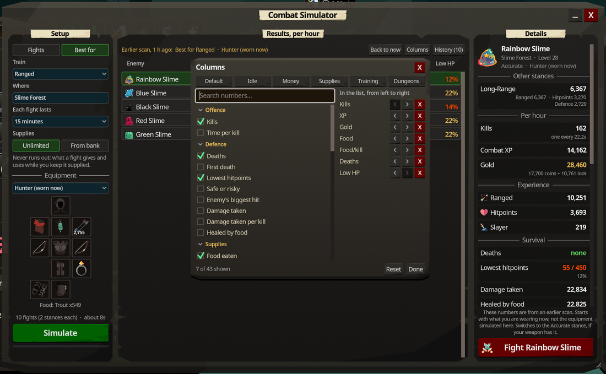

**Columns**, next to History over the list, opens every number the simulator has, in groups, with a tick
in front of each. Tick a number to add it to the list, untick it to take it out: the list changes as you go.

- **Presets** along the top put a set of columns in place with one click, and you can change the ticks
  afterwards. **Default** is the list as it starts. **Idle** answers "can I leave this running?": Safe,
  Deaths, First death, Low HP, Max hit and Food/kill. **Money**, **Supplies** and **Dungeons** do what they
  say, and **Training** shows XP, XP/kill and the XP of each combat skill that gained any in the list (in
  "Best for", not the skill you train: the XP column already is its XP).
- **The groups** fold and open with a click on their name. The search box finds a number by its name:
  "rune" finds Runes used and Runes per kill.
- **In the list, from left to right**, on the right, is the order of the columns. Move one with its two
  arrows, or take it out with its red X. One column always stays.
- **Reset** brings back the seven columns the list starts with. **Done** closes the picker.
- Put the pointer on a number in the picker, or on a column's name over the list, for what it is, when it
  shows `-`, and which way is better. Over the list, the tooltip of a short name like **Dmg taken** starts
  with the whole name. At the smallest window sizes a name too long for its column is cut short with `...`,
  and its tooltip starts with the whole name too.

Your choice is kept in `settings.json`, also after the game is closed. In "Best for" the XP column is always
there, named after the skill you train; when you did not tick it, it comes first.

The window keeps its width whatever you choose, so it covers no more of the game than it does with the seven
columns it starts with. Fewer columns leave more room to the enemy's names. When the numbers need more room
than that, only whole columns are in sight, and a bar under them moves them sideways a column at a time,
while the enemy's name stays where it is. Shift with the mouse wheel, or a sideways swipe, moves them too.

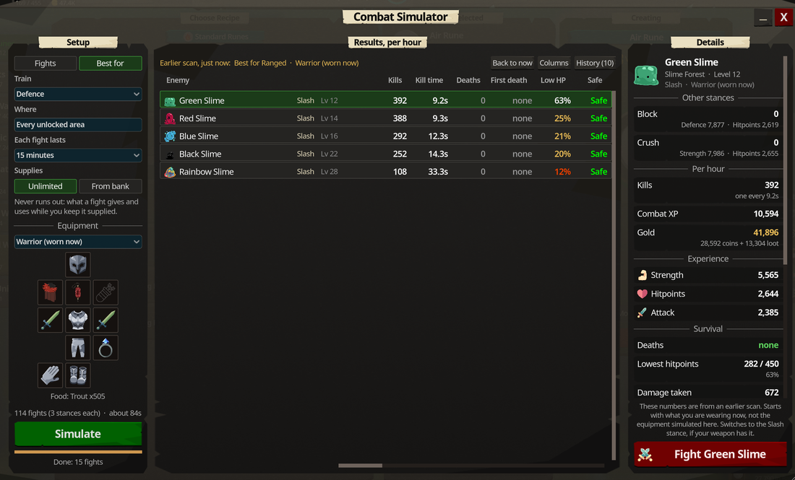

## Choosing where

"Where" opens the list of everything you have unlocked. Tick one area, several, a whole category by clicking
its heading, or nothing at all for everything. There is a search box. The line at the bottom counts the
fights you have ticked: an area is one fight per enemy in it, a dungeon is one fight.

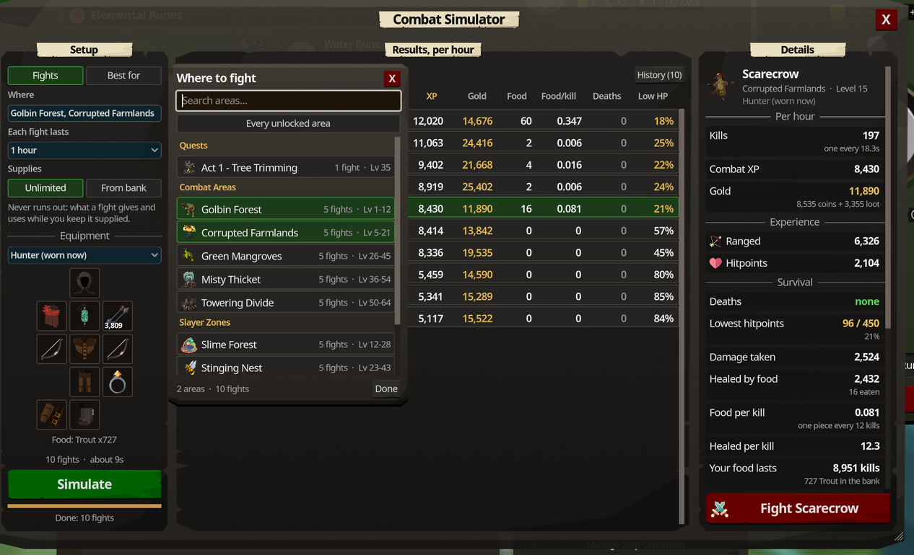

"Fights" and "Best for" each remember their own choice of areas.

## Trying other equipment, stances and spells

**Loadouts.** The box under Equipment lists your saved loadouts. Simulate a fight with one, switch to
another, simulate again: Details compares the two. To run two setups at once and see every fight with both,
tick Compare: see [Comparing two setups](#comparing-two-setups).

**Single items.** Click any slot to open every item of the game that fits it, the ones you own first. Type
to search; "Only items I own" hides the rest. A slot you changed gets a gold frame, and "Undo changes"
brings the loadout's own items back. An item you do not own is handed to the copy so you can see what it
would do; an item whose requirements you do not meet cannot be equipped by the copy either, and the result
says so. To try the items that fit a slot, up to 40 in one go:
[Find upgrades](#what-to-get-next-find-upgrades).

**Two-handed weapons** fill both hands, as on the game's own equipment screen: the Offhand shows the weapon
too, faded the way the game shows it. Picking a two-handed weapon takes off what is in the Offhand, picking
an item for the Offhand takes the two-handed weapon off, and "Nothing" in the Weapon slot empties both
hands. A slot gets the gold frame, and counts as a change, when its own item comes off or another goes on:
a shield in place of a two-handed weapon is two changes, the shield and the Weapon slot left empty. If the
copy ever wears something other than the slots show, the result says so.

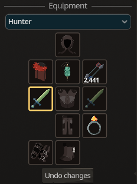

  
  &nbsp;
  

**Stances.** In Fights, a "Stance" box under the slots lists the attack stances of the weapon in the slots, in
the game's own names and with its pictures of them. The first choice fights in the stance the game has
selected for that weapon, as before: it says which, **As now: Accurate**, when the slots show the loadout you
wear with a weapon of the kind you hold, and **As the game has it** otherwise (another loadout keeps a stance
of its own). Choosing a stance makes it a setup of its own, as a spell does: "With: Loadout 1, Defensive
stance" above the list, and Details compares it with the other stances you simulated. Choosing the stance you
are in already is a setup of its own too, with its own luck (in [Compare](#comparing-two-setups) the two meet
the same dice and come out the same): Details then says which of the two was chosen and which was as the game
has it. Swap in a weapon of another kind, a bow for a sword, and the box offers the
bow's stances; a stance the new weapon does not have goes back to the first choice. A weapon with a single
stance has no box, and neither has Best for, which tries every stance.

  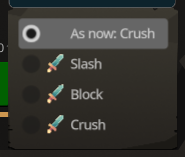
  &nbsp;
  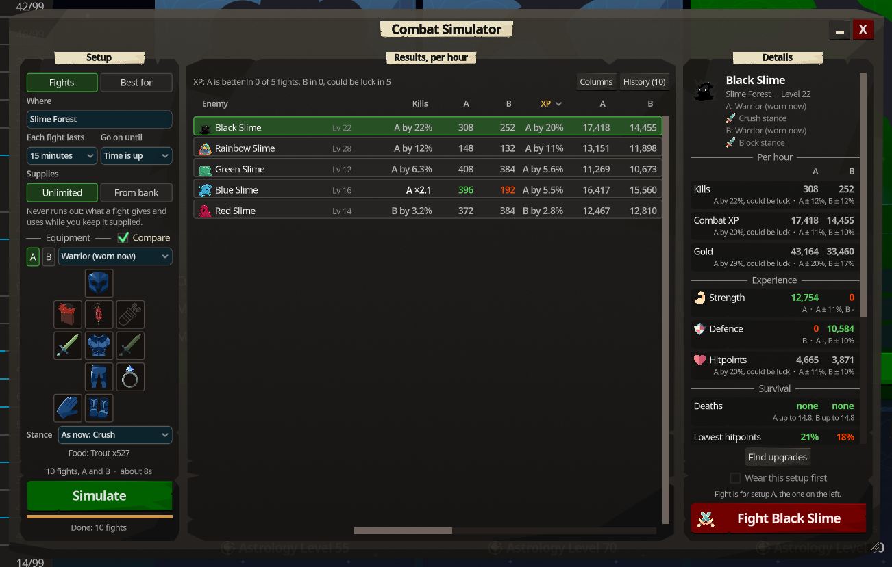

**Spells.** When the weapon of the setup casts spells, a "Spell" box appears under the slots with the spells
that weapon can cast. Choosing one makes it a setup of its own, so two spells are compared the same way two
weapons are.

## Comparing two setups

> Which of my two setups is better, and where?

Tick **Compare**, at the end of the Equipment heading. Two buttons, **A** and **B**, appear in front of the
loadout: the one that is down is the setup that the loadout, the slots, the stance (in Fights) and the spell
under them show and change. The first time, B is a copy of A: press B, then choose another loadout, click a
slot to swap an item in, or choose another spell, or in Fights another stance. Each setup keeps its own
stance, of its own weapon; Best for tries every stance of both. Press A to see A again. Put the pointer on A
or B for the whole name of its setup.

One press of **Simulate** runs every fight with A and with B, from the same moment of your character and with
the same dice (see [The same dice](#the-same-dice) below). The line above Simulate says how many fights that
is for the two together and about how long it takes. While A and B are still the same setup, it says **A and
B are the same setup**: the list says what to do, and Simulate waits until you change one of them.

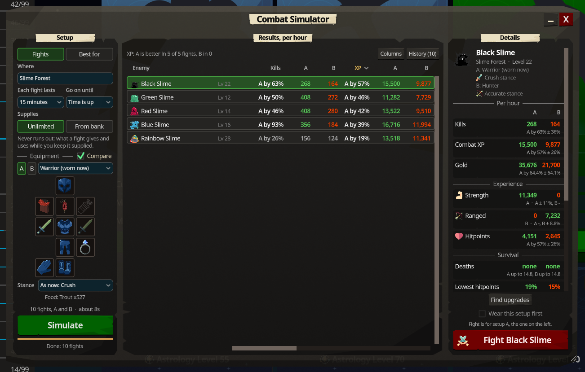

The list has one line per fight, and every column you chose is three cells. The first, under the column's
name, says which setup is better and by how much: **A by 23%** means A's number is 23% better than B's, so 23%
more XP, or for food, food per kill and deaths, 23% less. From twice as much up it says how many times:
**A ×4**. Then come the numbers with **A** and with **B**, the better one green and the worse red; where the
difference could be luck, both are grey and so are the words before them. **the same** is less than half a
percent apart. Low HP, Safe, First death, Net gold and Best drop say only which is better, and so does a
number against 0. Neither is better for Healed, Items and Sim time: there the first cell says which setup has
more, **A +12%**. A `-` means that setup has no result or no number for the fight. The three cells of a column
move sideways together, and are in sight together. Put the pointer on a line for the stance each setup fought
in, the 95% ranges of both and, where the same dice decide, each lead with its ±. Details names each setup's
stance under its name, with *as the game has it* when both fought in the same stance but only one of them
chose it.

Click a column's name to put the fights where the choice matters most on top: those where one setup is
clearly better, the furthest apart first, then those that could be luck, then those that are the same. Click
it again for the other way round. **A** or **B** sorts by that setup's own number. The line above the list
counts the fights each setup wins in the column the list is sorted by, for example *XP: A is better in 7 of
12 fights, B in 4, the same in 1*. Put the pointer on it for the names of the two setups.

In **Best for**, each line compares A's best stance in that fight with B's. Under the count, the line above
the list says where each setup does best and which setup is better there, for example *Best with A: Black
Slime, A ×5.5  ·  Best with B: Rainbow Slime, A ×3.5*. The lines name no stance, so that the enemy's
name keeps the room it has in Fights; the pointer on a line, and Details, name the stance of each setup.

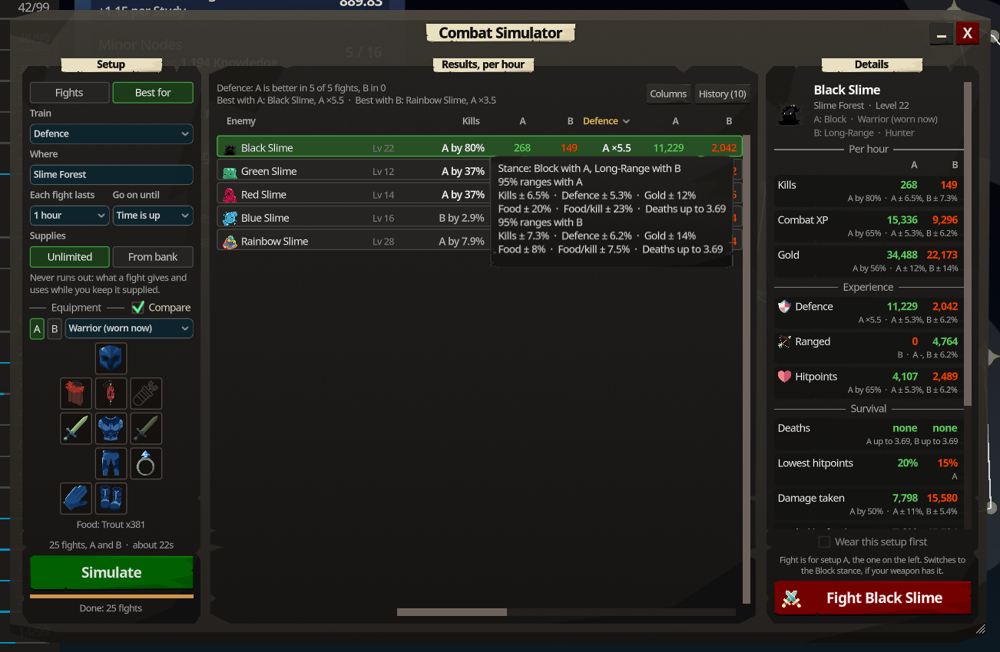

**Details** shows the selected fight with both setups side by side: kills, combat XP and gold per hour, the
XP of each skill, deaths, the lowest hitpoints, damage taken, healing, food per kill, and what each setup
used. Under a number, which is better and by how much, in the words of the list, and the 95% range of each
setup; where the same dice decide, the lead with how far luck could move it instead, **A by 48% ± 47%**. For
the loot item by item, untick Compare: the list then shows the setup on the left alone, with its numbers from
the compare, which move a little when you simulate it alone.

  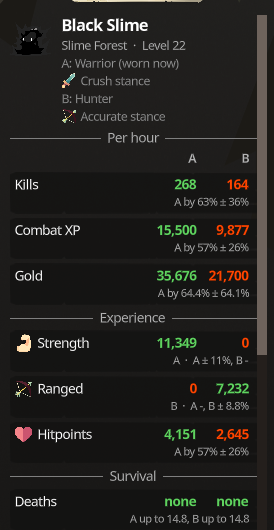
  &nbsp;
  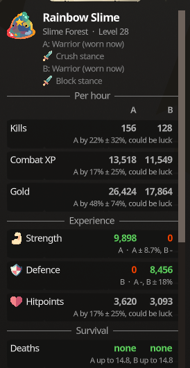

**Fight** is for the setup on the left: its stance, and with **Wear this setup first** ticked, its
equipment. The text above Fight starts with *Fight is for setup A, the one on the left.* To fight with B,
press B first. When the setup on the left has no result for the selected fight yet, the text says so where
the button would be.

A and B are kept until you close the game or open another character; Compare starts unticked then. A scan of
two setups goes into History as **A against B: ...**, with both setups named.

### The same dice

A and B are fought with the same dice, kept in step all fight the way
[Find upgrades](#what-to-get-next-find-upgrades) does it: the first, second, third enemy meets the same rolls
with A and with B. Luck they meet alike cannot put one ahead of the other, so it is taken off the bar. A
number is green or red when the difference is larger than the two 95% ranges laid side by side would allow,
less the share of the luck that A and B met alike. That share is measured from the two fights at the same
kills, and could itself come out a little low by chance, so only what is beyond that chance is taken off: two
setups that meet no luck alike are coloured by luck about as often as two ranges side by side. Details
writes the bar as the lead and its ±, **A by 48% ± 47%**: green and red exactly when the lead is larger than
its ±. Where the two would read the same, both get one more figure: **A by 64.4% ± 64.1%**. The more alike
the two fight, the more luck they share: two helmets, or one weapon in two stances, share much of it;
Warrior and Mage, who attack at other speeds, share almost none. Each one's own range is still in the
line's tooltip.

Judged as before, by the two own ranges side by side: a count that did not come in every part of either
fight, like a death or two; a number one of them had none of; fights that ended at different times (Go on
until, or From bank when the supplies ran out); fights whose dice could not be kept in step; and scans made
before this.

## What to get next: "Find upgrades"

> What should I get next for this fight?

Simulate the fight, click its line, and press **Find upgrades**, the button over "Wear this setup first" under
Details. Nothing runs yet: a panel opens over the list, where History opens, and there you choose which items
to try, one slot at a time, on top of the setup on the left, against that fight.

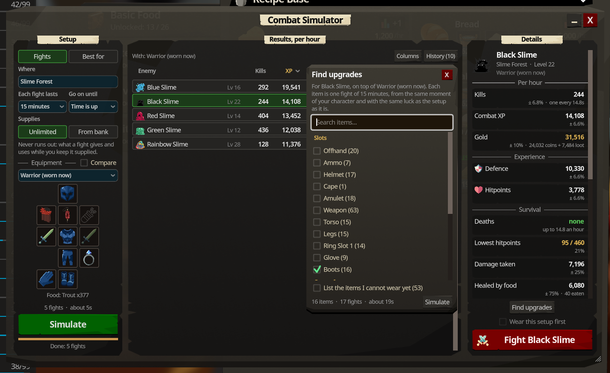

- **Slots**: the slots of the setup on the left. Tick one or a few; none ticked is every slot.
- **Comes from**: **Owned** (in your bank or worn now), **Drops in** the area of the fight, and the kinds of
  the Item Encyclopedia's "Comes from" filter: Enemy drop, Skill, Shop, Chest, Thieving, Quest, Upgrade, No
  source. None ticked is every item. The game's data is read the first time you open the panel; until then
  only Owned can be chosen.
- **Search items...**: only the items with these words in their name.
- **List the items I cannot wear yet**: see below. They cost no fight.

Each tick says how many items it stands for, with the rest of your choice as it is, and clicking **Slots** or
**Comes from** unticks the whole group. The line beside **Simulate** says what a press runs: "16 items · 17
fights · about 19s", by the estimate of the line above Simulate. One press tries at most 40 items: with more,
Simulate is greyed until you tick fewer slots, or where they come from. Your choice is kept for the next time.

Each item is one fight of the length chosen on the left, and the setup as it is is fought once more beside
them; "Go on until" is not used, so all are as long. A search fights one at a time, so the game you play stays
smooth: it runs in the background like a scan, the items come into the list in the middle as they are tried,
the line over the list says how many are done, the line under Simulate names the item being tried, and the
folded title counts the fights. **Stop**, where the button was, or Cancel on the left, stops it; the items
tried so far stay.

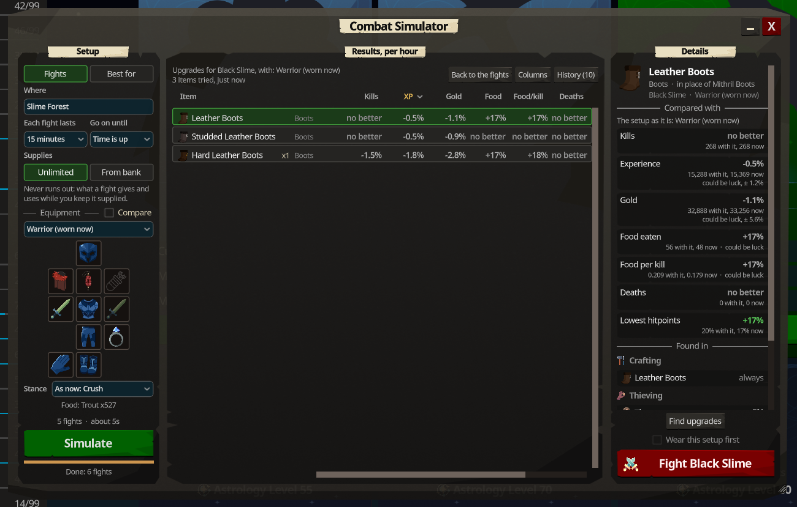

- **The same moment, the same luck.** The setup as it is and every item are fought from the same moment of
  your character. Every item is fought with the same luck as the setup as it is, so a difference comes from
  the item, not from the dice. For that the setup as it is is fought once more, so its numbers in Details can
  differ a little from its line in the list of fights, which had dice of its own. An item goes on the way a
  pick in that slot's item picker puts it on: a two-handed weapon takes the shield off too, and a shield takes
  the two-handed weapon off, which leaves the Weapon slot empty. The tooltip of a line says what the item went
  on in place of. In Best for, every item is fought in the stance of the line you selected, and in Fights in
  the stance chosen in the Stance box, when its weapon has that stance; when it does not, the game's own
  stance for it is used. An item that fought in another stance than the setup as it is, such as a weapon of
  another kind, says so: its line's tooltip names both stances,
  **Stance: Accurate, as the game has it (no Defensive with this weapon)**, and its Details name its stance
  under the setup, and the setup's under "The setup as it is".
- **What it adds.** Every column you chose for the list says what the item changes in it, in the words of
  Compare: **+14%** is 14% more with it, **-23%** 23% less, **×2.5** two and a half times as much, **+7,300**
  that much where there was none, and for Net gold how much more or less, **+1,200**. Green is better and red
  is worse, the way the column says (more XP, fewer deaths), and grey where it could be luck because the two
  95% ranges overlap. **no better** is less than half a percent apart. For Healed, Items and Sim time neither
  is better: no colour, and "the same". Only words stay the item's own, coloured: Safe or Risky, the name of
  the best drop, and a first death where one of the two never dies ("none", or the time). Put the pointer on a
  column's name for its words.
- **The order.** Click a column's name to sort by what the item adds there: the first click puts the clear
  gains on top, the largest first, then the gains that could be luck, then no better, then the losses that
  could be luck, then what makes it worse. **Item** sorts by name and **Comes from** puts what you have first.
- **Comes from** is Item Sources' answer: the headings of its list, such as "Combat", "Smithing" or "Combat,
  Opening". Put the pointer on it for how many places each heading has, and click the line for every place. An
  item you have says **In your bank** instead, or **Worn now**, and "x3" after its name says how many your
  bank holds: the cheapest upgrade is the one you have already. Until the game's data is read, the cells say
  `...`.
- **Items you cannot wear yet.** An item whose requirements you do not meet, such as a level, cannot be worn
  by the copy either, so it is never tried. With **List the items I cannot wear yet** ticked in the panel,
  they come at the end of the list once the search is done, with what they need in grey beside their name, in
  the game's words: "Level 40 Attack". At most 60 are listed.
- **No numbers.** An item the copy could not put on as asked (no arrows in your bank with supplies From bank,
  an item the game would not equip) says why in gold beside its name instead of numbers, and a fight that
  failed in red.
- **Details.** Click a line: every column with both numbers ("13,815 with it, 12,100 now") and where the item
  comes from, place by place, as the Item Encyclopedia lists it. Fight under it is still the selected fight
  with what you have on: Find upgrades never puts anything on.
- **Back to the fights**, over the list, leaves the items; the fight they were tried for stays selected. The
  button under Details then says **Show upgrades** and brings them back, while the search runs and after it,
  as long as the setup on the left is the one they were tried on. Over the items, Find upgrades opens the
  panel for another search. They are not kept in History or on the enemy cards: search again for the numbers
  of a later moment.

Find upgrades is greyed while an earlier scan is on show or a scan is running. Two slots at a time are not
tried: for a new weapon and a new shield together, pick one in its slot and press Find upgrades again.

## Finding where to train: "Best for"

"Fights" answers "what do these fights give". **Best for** answers "where should I go". Choose the skill you
want to train (or all combat XP) and where to look. Every fight is run once in each attack stance of your
weapon, because the stance decides which skills get the XP, and each line shows the stance that trains your
skill best. The other stances of a fight are listed in its Details. A weapon with a single stance is simply
run once. Best for has no Stance box: the stance chosen in Fights waits there for when you come back.

A scan of everything is many fights: the line above Simulate tells you how many and how long before you
start. Tick fewer areas to keep it short.

## Supplies: unlimited or from the bank

- **Unlimited** hands food, runes, arrows and prayer points back as they are used. These are the rates of a
  fight that is kept supplied: use it to compare places, equipment and spells.
- **From bank** uses what you own right now. Use it with a long duration to see how far your supplies get
  you: the note on the result says what ran out and when. Without arrows or runes the fight ends there.
  After the food runs out, the fight continues until the time is up or you die ten times in a row without a
  kill. If it ends early, the note says why and the rates cover the time fought. "Your food lasts" in the
  details says how many kills the food was enough for.

Either way, "Used" in the details tells you what an hour costs.

## Earlier scans

Every simulation you run is kept: the last ten for each character, also after the game was closed.
**History** lists them with what was asked and what came out on top. A click shows that scan again, table
and details, without simulating anything. While nothing has been simulated yet, the newest three are offered
right in the empty table.

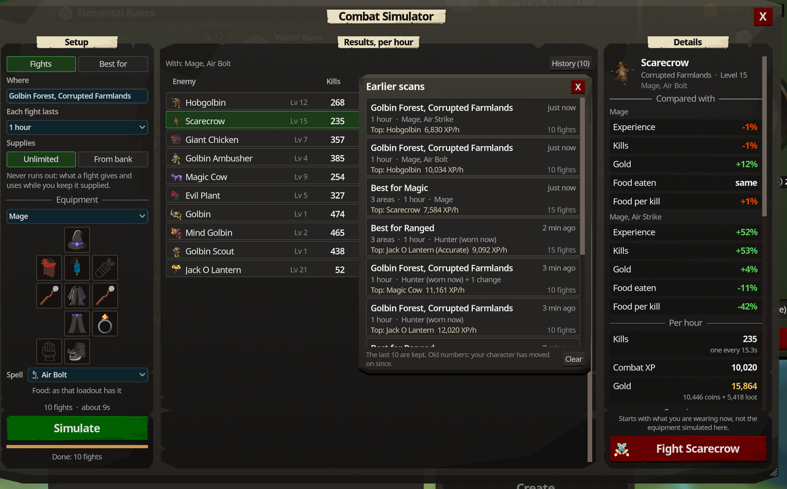

The numbers of an earlier scan are from then: your levels and equipment may have changed since. A gold line
says so while one is on show, and "Back to now" leaves it. A scan of two setups is called **A against B** and
shows its list with both, whether Compare is ticked or not; its top line says which setup it came with, and
the gold line names the scan above the count of wins.

## On the enemy cards

In the game's combat areas menu, where you pick an enemy to fight, each enemy's card gets a small tag at its
bottom with the simulator's chart on it. It shows the newest scan of that enemy made with what you have on
now:

- **Safe**, in the game's green: you did not die, and no hit of that enemy reaches the point where auto eat
  steps in, so no hit can take you from just above that point to nothing.
- **Risky**, in the game's red: you died in the scan, or one hit of that enemy can be as big as your hitpoints
  at the auto-eat point, or auto eat cannot heal you (no food selected, or none left in a From bank scan).
- Then **XP per hour** and **deaths per hour**, the numbers of the table. After a Best for scan it is the XP
  of the skill you chose, in the stance you have selected now.

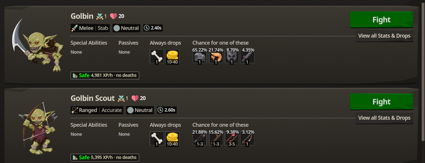

"What you have on now" is your equipment, toolbelt, attack stance, spell, food and prayers. Your levels do
not count, so the tags stay after a level up. When every scan of that enemy was made with something else,
the tag is grey and says **Other setup**: simulate again for Safe or Risky. An enemy you have not simulated
gets no tag, and neither do the enemies of a dungeon, which is simulated as a whole.

The biggest hit is the most the game says that enemy's attacks can deal, or a bigger loss of hitpoints that
really happened in the scan. Food counts as the scan had it: in a From bank scan, food that runs out makes it
Risky; Unlimited never runs out.

Put the pointer on a tag for when the scan was made, how long it was and in which stance, and the hit and the
auto-eat point in numbers. Click it to open that scan in the simulator, with the enemy selected and its area
ticked for the next Simulate. Opening the menu never simulates anything.

To hide the tags, untick **Show on enemy cards in the combat areas menu** at the bottom of History.

## The Fight button

The red button under the details starts the selected fight in the game, the way the game's own area menu
does, and closes the window. The small text above it says exactly what else it will do: switch to the stance
of that result when one was asked for (the stance of a Best for line, or the one chosen in the Stance box; a
result made As the game has it leaves your stance as it is), and select the spell when the result was
simulated with what you are wearing. With Compare ticked it is for the setup on the left, and the text says
which one that is.

**Wear this setup first**, the tick box above the button, is off until you tick it, and stays as you leave
it. Unticked, Fight never changes your equipment: if you simulated other items, you still have to put them on.
Ticked, Fight first puts on what the selected result was simulated with, through the game's own actions, and
then starts the fight:

| The simulated setup | What Fight does first |
| --- | --- |
| Another saved loadout | Changes to it, as the game's own loadout buttons do. The loadout comes with what the game keeps in it: its food, prayers, attack stance and spells. |
| An item you swapped in | Puts it on from your bank, as the game's equipment screen does; what it replaces goes back to the bank. Arrows and other ammunition: as many as your bank holds, never more; the same arrows already in their slot are left as they are. |
| A spell you chose | Selects it. |
| An item that is not in your bank | Skips it: that slot stays exactly as it is. So does a slot whose item you cannot wear yet or wear in another slot, and one whose old piece your bank has no room for. |
| A slot you emptied | Nothing: what you wear there stays on. Fight only puts on pieces from your bank; it never just takes one off. |

With the box ticked, the small text above the button names every step before you press it, for example
*Wears Loadout 2, puts on Adamant Sword and 1,250 Bronze Arrows in place of Iron Sword, skips Gold Ring (not
in your bank), switches to the Stab stance, if your weapon has it, then fights Scarecrow.* When nothing goes
on, it says why first, for example *Puts nothing on: skips Gold Ring (not in your bank).* Fight never does
more than that text says:

- If your equipment or bank changed after the text was written (an item sold, a slot changed by hand), Fight
  puts nothing on and starts no fight. The text is written again: read it, then press Fight again.
- After a change of loadout, Fight first makes sure the game has put on what that loadout keeps. Before each
  item, it asks the game again: an item that can no longer go on as the text said stays off, and the others
  go on.
- When everything went on as the text said, the window closes as before. When a slot stayed as it was, or
  something did not go as the text said, the window stays open and a gold line says what really happened,
  for example *Fighting Scarecrow. Wore Loadout 2, put on Adamant Sword in place of Iron Sword. Gold Ring did
  not go on: not in your bank.*
- If the game does not do a step the way it should, Fight stops there and does not start the fight, so you
  can look at your equipment first.

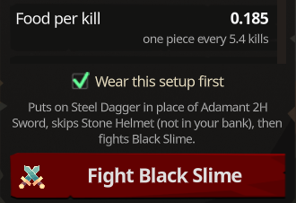

Nothing is ever bought, made or given, and nothing is put back after the fight: the game keeps the change as
when you put an item on by hand. What your bank has no room for stays on you: if it cannot take back what
another loadout takes off, Fight does not change the loadout and puts nothing on. The box does not choose
food itself: another loadout comes with the food the game keeps for it, and the simulation had that food too.
When the box puts nothing on for the selected fight, it looks greyed and says why when you point at it, and
Fight does what it does unticked. It can always be ticked and unticked.

## Questions it answers

- **Where do I train Ranged fastest?** Best for > Ranged > Simulate. The top line is the place, and names
  the stance.
- **Is this weapon worth buying?** Simulate your area, click the weapon slot, pick the weapon (you do not
  have to own it), simulate again, read "Compared with".
- **What should I get next for this fight?** Click the fight's line, press Find upgrades, tick a slot or two,
  press Simulate. The top line adds the most to the column the list is sorted by, and In your bank marks what
  you have already.
- **Which of my two setups is better, and where?** Tick Compare, press B and make it the other setup, press
  Simulate. The fights where the choice matters most are on top, and the line above the list counts the
  fights each setup wins.
- **Is it really better, or was that luck?** "Compared with" is green or red only when the two ranges do not
  overlap, and grey with "could be luck" when they do; between A and B of one compare, only when the change is
  larger than its ±. Go on until ± 2% sure narrows the ranges where it is close. Compare fights both setups
  with the same dice, which takes the luck they meet alike off the bar.
- **Can I leave this running overnight?** From bank, 12 hours. No deaths, and no "Ran out of" or "Stopped
  at" note, means yes; the enemy's card in the combat areas menu then says Safe. Low HP tells you how close it
  was. Columns > Idle puts Safe, the deaths, the first death and the enemy's biggest hit side by side for
  every fight.
- **Which fight makes my food last longest?** Click Food/kill: the top line eats the least for each kill.
  "Your food lasts" in its details says how many kills the food in your bank is enough for.
- **Which spell?** Simulate once per spell and compare. Columns > Supplies shows the runes each one uses.
- **Which stance for this weapon?** Best for tries them all and names the best. In Fights, choose one in the
  Stance box and simulate, or tick Compare and give B another stance.
- **Where is the gold?** Simulate everything and sort by Gold. Columns > Money adds what the supplies cost
  and Net gold, the gold that is left after them.

## How it works

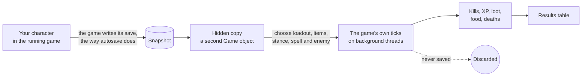

- Every fight starts from a **fresh copy** of the same snapshot, so one result cannot leak into the next. Its
  dice are set from the fight and the setup, so the same setup and the same character give the same numbers
  again (see [below](#the-same-setup-and-the-same-character-give-the-same-numbers)).
- Loading a copy takes about a second, an hour of fighting about a quarter of one. Up to four fights run
  side by side, leaving half of your processor to the game you are playing: thirty-eight fights of an hour
  each take about half a minute.
- Because it is the game's combat, everything the game does is in the numbers as it is set when you press
  Simulate: your levels and bonuses, active prayers and potions, auto eat, special attacks, the enemy's
  passives.
- A copy is let go completely when its fight is over, so a long scan does not fill the memory.

## How far to trust the numbers

Fights are random, so every rate the simulator shows comes with its 95% range: a range worked out this way
holds the true number 95 times in 100.

- **± 2%** after a number: the true rate is within 2% of it, either way.
- **0.62 to 8.77**: a range that is not the same on both sides. Deaths, a dungeon's runs and anything else
  that is counted one at a time and did not come in every tenth of the fight have one, because so few cannot
  be told to a percent. So does a number whose range reaches 0.
- **up to 3.69**: there were none. **0 deaths in an hour is not "never"**: up to 3.69 deaths an hour would
  fit what was seen. Simulate 12 hours without a death and it is up to 0.31.
- A number that was 0 all fight and is not counted one at a time, like no damage taken, has no range.
- Put the pointer on a line of the list for the ranges of its numbers. In Details the range of each rate is
  on the small line under it.
- A scan made before the ranges were counted has none. Simulate again for them.

The range comes from the fight itself: it is cut into ten parts of the same game time, and how much the parts
differ says how far the whole could be off. This is statistics, not a rule of the game: no number of the game
is worked out by it. The longer the fight, the narrower the range: four times the time gives half the range.

**A rare drop that did not come is in no range.** A range only knows what the fight saw. When much of an
enemy's gold comes from a valuable drop that comes about once in the time simulated, or less, a fight that
never got it shows gold that looks steady, with a narrow range, and the true gold can be well above it.
Look at Loot in Details for what the gold is made of, and simulate such an enemy for 12 hours.

### The same setup and the same character give the same numbers

The dice of each fight are set from the fight and the setup. Press Simulate again with nothing changed and you
get the very same numbers. [Find upgrades](#what-to-get-next-find-upgrades) gives every item it tries the dice
of the setup as it is instead, so that each is fought with the same luck, and [Compare](#the-same-dice) gives
A and B the dice of the fight alone: a setup's numbers there can differ a little from its numbers alone.

Your character counts as part of "nothing changed": the copy is your character at the moment you press
Simulate. Its XP decides when a level comes during the simulated time, its slayer task when that task ends,
and its potions how long they last. While you fight or train, these move on, so a scan a minute later can
come out a little different: a few XP or a kill, and more for the enemy of your slayer task. The ranges are
about luck and do not cover such changes. To compare two setups, use [Compare](#comparing-two-setups): it runs
both from the same moment.

### Go on until

**Go on until**, beside "Each fight lasts", keeps simulating each fight after its time until every number in
the list is known to the size you choose: **± 1% sure**, **± 2% sure**, **± 5% sure** or **± 10% sure**, 12
hours of fighting at most. **Time is up**, as it starts, simulates exactly the time on the left.

- It goes by the numbers the list shows ([Choosing the columns](#choosing-the-columns)): a number you do not
  show does not hold a fight back.
- A range halves for four times the time, so the simulator can tell how far 12 hours would bring a number. One
  that 12 hours cannot bring within your size is waited for until it is within the next larger size it can
  reach: with ± 2% sure, a number that could only get to ± 4% in 12 hours goes on until it is within ± 5%.
- A number that 12 hours cannot bring even within ± 10% does not hold a fight back and is left as it came
  out: most often a few deaths, gold that hangs on a valuable drop, or a number close to 0. A number that is
  0, like no deaths, holds nothing back either.
- **A smaller size never ends a fight sooner than a larger one**: it waits for everything the larger one
  waits for, and more.
- It is greyed out with supplies From bank: those fights are about how far your supplies get you in the time
  you chose.
- The line above Simulate says the most the run can take: `up to 2 min`. Cancel stops it like any run.
- The Fought column and the last line of Details say how long each fight was simulated. Low HP, First death,
  Max hit, Safe and the tag on the enemy's card are of all that time: a fight that ran longer had more time to
  get low or to die once, so read them with its length in mind. The other numbers are per hour, per kill or
  per run, and compare as they are.
- A fight that ends as soon as its ranges are small enough sometimes ended on a lucky stretch, so its ranges
  are a little less sure than 95%. For a close call, choose the next smaller size.

The simulator was compared with the real game once: 4,188 XP per hour simulated against 4,125 on the game's
own ten minute average for the same fight. That is one point, not a proof. Tell us when you see it off.

## Settings and files

Everything is in `mods\CombatSim`:

- `settings.json`: the window's place, size and folded state, your last choices (Go on until is `"Sure"`, in
  percent, 0 for Time is up) and the list's columns (`"Columns"`, `null` while they are the ones the list
  starts with). `"Workers"` sets how many fights run side by side, 1 to 8 (0 lets the mod choose: half of the
  processor, four at most). Lower it if the game stutters during a scan.
- `history\<character>\`: the earlier scans. Delete the folder, or press Clear in History, to forget them.

## When something is off

| You see | What it means |
| --- | --- |
| A fight is missing from the table after Cancel | A fight that was cut short is dropped; the finished ones are kept. |
| "... could not be equipped (requirements not met?)" | The copy follows the game's rules: you do not meet that item's requirements. |
| "The copy did not wear what the slots on the left show: ..." | The game put the equipment on differently from the slots on the left, and the numbers are for what the copy wore: the line names what it fought without, or with. If your equipment changed while the window was open, open it again; otherwise report it with the log. |
| The Offhand of a two-handed weapon is as faint as an empty slot | The game's look for it could not be read from its combat screen: `MelvorModLoader.log` has a line `[CombatSim] The game's tint for a slot that a two-handed weapon fills`, and a game update changed that screen. Once you have opened the game's own equipment screen, the simulator takes the look from there. |
| A two-handed weapon fills only the Weapon slot | Look for `[CombatSim] Two-handed weapons cannot be read` in `MelvorModLoader.log`: a game update changed what the simulator reads. Every slot works on its own, as before, the result says so when the copy wears something else, and Wear this setup first is off. |
| "Ran out of ... after ..." | From bank: that supply was used up. Without arrows or runes the fight ended there; without food it went on. |
| "Stopped at ... after 10 deaths without food or a kill" | From bank: the food was gone and you died ten times in a row without killing anything. The fight ended there; the numbers are of the time until then. |
| "The fight could not be started" | The game refused to start it for the copy, usually an unmet requirement of the area. |
| With Go on until, fights of 12 hours | A number of the list could get within the size, or the next larger one, but only just in 12 hours. Show fewer columns, or choose a larger size. |
| With Go on until, a fight that did not go on | Every number of the list was within the size already, or 12 hours could not bring it even within ± 10% (a few deaths, gold from a rare drop). |
| With Go on until ± 2% sure, a number still at ± 4% | 12 hours could not bring that number within ± 2%, so the fight waited only until it was within ± 5%. |
| No range in the tooltip or in Details | The scan was made before the ranges were counted: simulate again. Or the number was 0 all fight and is not counted one at a time, like no damage taken. |
| "A and B are the same setup" above Simulate | B is still a copy of A. Press B and change its loadout, an item or its spell, or in Fights its stance: Simulate waits until the two differ. In Best for, which tries every stance, two setups that differ only in the stance chosen in Fights are the same. |
| With Compare, a line with `-` for one setup | That setup has no result for the fight: you changed it after the scan, or its fight could not be simulated. Press Simulate again. |
| With Compare, a loadout's name cut short | Beside A and B the drop-down has less room than alone. Put the pointer on A or B for the whole name. |
| "The game did not write a fresh save to simulate from" | The snapshot could not be taken. Try again; if it stays, report it with the log. |
| "This game version loads saves differently" or "copies are not being released" | A game update changed something the simulator depends on. It needs an update; the rest of the game is unaffected. |
| No tag on an enemy card | That enemy has no scan yet (scans made before the tags existed do not count), its fight failed, it belongs to a dungeon, or the tags are switched off at the bottom of History. If no card ever gets one, look for `[CombatSim] The tags on the enemy cards are switched off` in `MelvorModLoader.log`: a game update changed the menu; the simulator itself keeps working. |
| "Other setup" right after a scan, with nothing changed | Report it with the log: your setup was read differently from the scan's. |
| "Skips Gold Ring (not in your bank)" above Fight, or "Gold Ring did not go on" after it | Wear this setup first only puts on what is in your bank. The other pieces go on, the fight starts with them, and the window stays open to say what stayed. |
| "Your bank has no room for ..." above Fight | That piece would have to go back to your bank, and the game says it does not fit there. Make room in your bank, then open the simulator again. |
| "Level 40 Attack" in grey on a line of Find upgrades, and no numbers | You do not meet that item's requirements: the copy cannot wear it either, so it was not tried. Untick List the items I cannot wear yet, in the panel of Find upgrades, to leave such items out. |
| A line of Find upgrades with a gold note beside the name and no numbers | The copy did not put the item on as asked, and the note is why: no arrows in your bank with supplies From bank, or an item the game would not equip. |
| Simulate greyed in the panel of Find upgrades | The line beside it says why: more than 40 items (tick fewer slots, or where they come from), no item in your choice, the game's data still being read, or a scan running. |
| `...` under Comes from | The game's data is still being read, once a character: it fills in a moment later. `-` means it could not be read: `MelvorModLoader.log` has a line `[CombatSim] Where items come from could not be read`. |
| "The stance ... is not available with this weapon" on a line of Find upgrades | That item's weapon has other stances than the one asked for (the stance of the line you selected in Best for, or the one chosen in the Stance box): it was fought in the stance the game chose for it, which its tooltip and Details name. |
| "The stance ... is not available with this weapon" on a fight | The copy could not wear the weapon the slots show (the note before it says why), and the weapon it wore has other stances: it fought in the one the game chose, which Details names under the setup. |
| Find upgrades greyed | An earlier scan is on show, or a scan is running. Put the pointer on it for why. |
| No Find upgrades button under Details | No fight is selected, or a game update changed what it reads: `MelvorModLoader.log` then has a line `[CombatSim] Find upgrades is switched off`. The rest of the simulator works as before. |
| "Your equipment or bank changed after the words above Fight were written" | Something changed between the text and your click. Nothing was put on and no fight was started: read the new text, then press Fight again. |
| "Wear this setup first" looks greyed | It puts nothing on for this fight; put the pointer on it for why. An earlier scan is on show; there is nothing to put on (you wear the setup already, or every changed item is skipped); that loadout is no longer there; your bank has no room for what the change of loadout takes off; Fight could not work out what to put on (`MelvorModLoader.log` says why); or a game update changed how equipment is put on (then `MelvorModLoader.log` has a line `Wear this setup first is switched off`). Fight then does what it does unticked. |
| "The fight was not started" after Fight, with Wear this setup first ticked | The game did not do a step the way it should: it had not finished changing the loadout, or it put on or took off something else. Fight stopped there; the gold line says what went on before. Look at your equipment, and report it with `MelvorModLoader.log`, which has the count of each piece before and after. |

## Install

Get the zip from <a href="https://github.com/Springs-Tea/melvor-idle-2-qol-mods/releases">Releases</a>, or from <a href="https://www.nexusmods.com/melvoridle2/mods/17">the mod's page on Nexus Mods</a> if you prefer.

1. Install the [Melvor Mod Loader](https://www.nexusmods.com/melvoridle2/mods/2) (0.1.3 or newer).
2. Open the game folder: Steam > right-click Melvor Idle 2 > Manage > Browse local files.
3. Extract the mod's zip there, so the file ends up as `mods\CombatSim\CombatSim.dll`.
4. Start the game. `MelvorModLoader.log` in the game folder has a line `Mod loaded: CombatSim`.

To update, extract the new zip over the old one. To remove the mod, delete `mods\CombatSim`. Its settings and earlier scans are in that folder too.
The mod never writes your save. Only Fight with "Wear this setup first" ticked changes your equipment, through
the game's own actions, and the game saves that as it saves any change you make.
