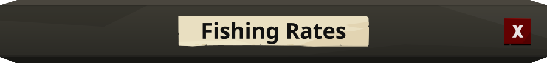
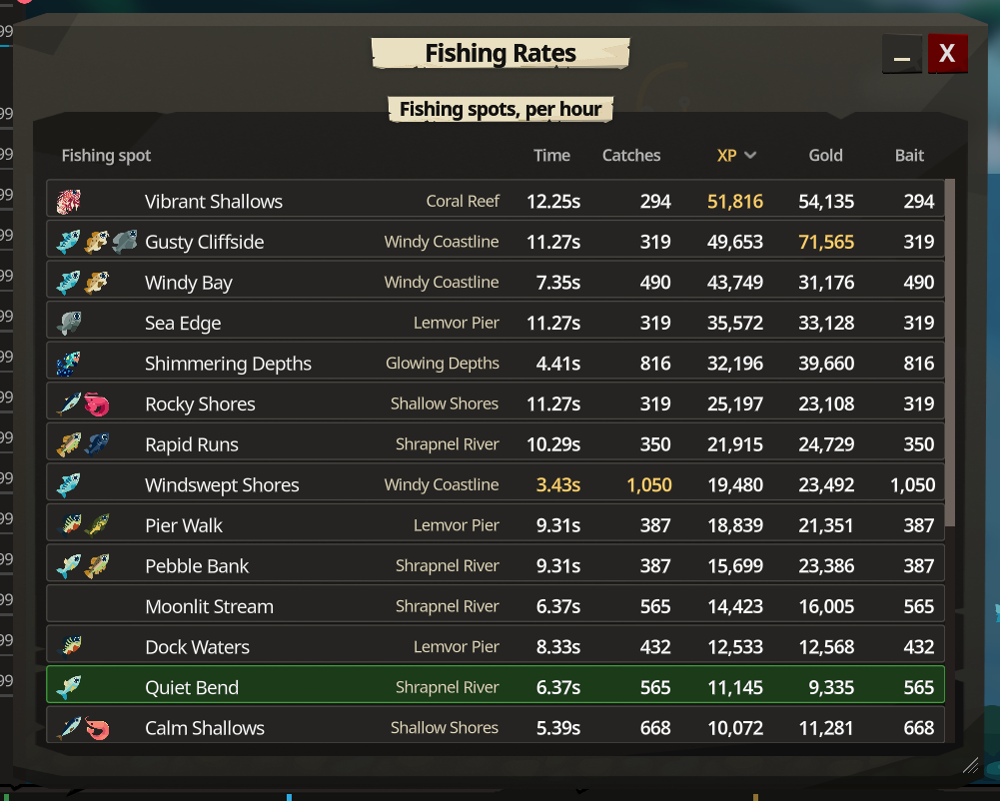
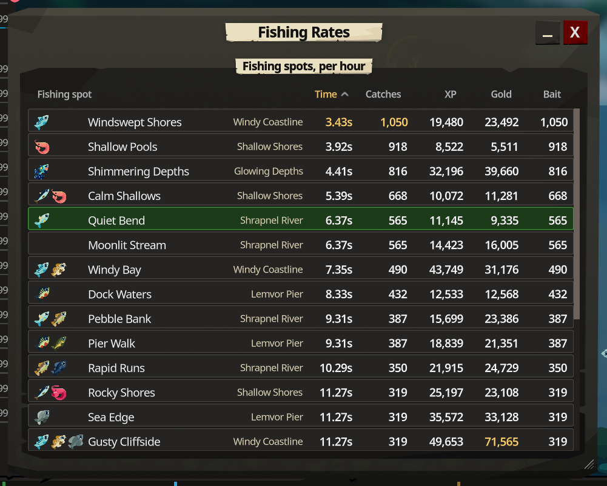
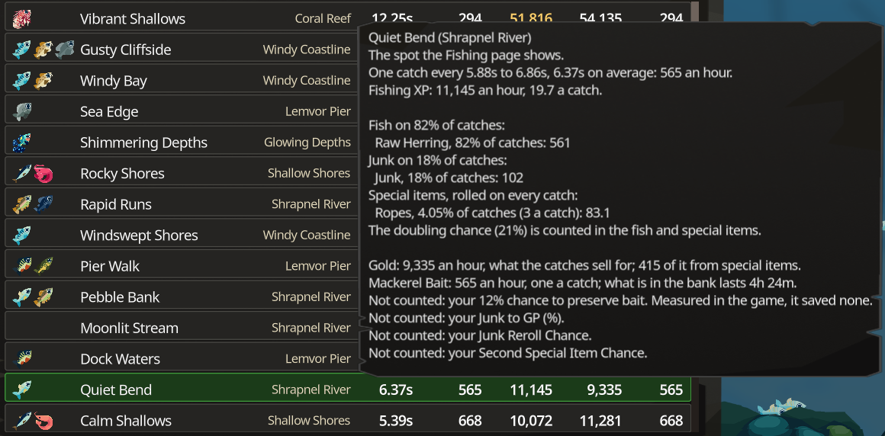

<h1 align="center"></h1>

  
  &nbsp;
  

> Where do I fish for the most XP, fish or gold per hour?

Every fishing spot has its own catch time, its own XP and its own fish, some with a chance at something
rarer. To compare them you would open the spots one by one and work out the hour in your head. Fishing Rates
puts them side by side: one line per spot, with what an hour there gives your character, from the game's own
numbers. Click a line to go to that spot on the Fishing page.

## Contents

- [Where it is](#where-it-is)
- [What the window shows](#what-the-window-shows)
- [The tooltip of a line](#the-tooltip-of-a-line)
- [What is counted](#what-is-counted)
- [Questions it answers](#questions-it-answers)
- [Good to know](#good-to-know)
- [When something is off](#when-something-is-off)

## Where it is

On the Fishing page, a round button with the Fishing icon joins the others on the right edge of the screen.
Click it to open the window, and again, or the red X, to close it. On a window folded down to its title, the
button opens it up again. It is lit while the window is open and not folded.

The button is only there on the Fishing page. On any other page the window steps aside; back on the Fishing
page, it is there again as you left it, open or folded.

Drag the window to move it, drag its bottom right corner to resize it, or fold it down to its title with the
button beside the X. It is never larger than fits above the game's bottom bar, and a list of more than 14
spots scrolls. Its place, size, fold and sort order are kept in `settings.json` in the mod's folder.

## What the window shows

One line per fishing spot the Fishing page shows you, in the order of the page: the pictures of the fish the
spot gives, the spot, its location, and per hour:

| Column | What it is |
| --- | --- |
| **Time** | How long one catch takes: the middle of the spot's catch time, with your bonuses. |
| **Catches** | Catches per hour, fish and junk together. |
| **XP** | Fishing XP per hour. |
| **Gold** | What the catches of an hour sell for. |
| **Bait** | The bait selected on the Fishing page, taken from your bank per hour: one every catch, also when your chance to preserve bait comes up, as measured in the game. Only there while a bait is selected. |

- **The best number of each column is gold**: the shortest time, the most catches, XP and gold. Bait has no
  best: it is the same number as Catches, since every catch takes one bait.
- **Click a column's name to sort by it.** The first click puts the best spots on top, the next turns the
  order around. "Fishing spot" goes back to the order of the page. The name the list is sorted by is gold,
  with the game's small arrow after it.
- **The spot the Fishing page shows**, the one its Start button would fish, has the lit outline of a selected
  line, so it can be found in a sorted list. Pick another spot or location on the page and the outline
  follows.
- **Click a line to go to that spot**: the Fishing page opens its location and selects the spot, as your own
  two clicks there would. Fishing is not started or stopped, and the window stays open. The pointer turns into
  a hand over a line a click takes somewhere.
- **While you fish, a line at the location you fish at selects no spot**: a click only opens that location,
  when the page shows another, and does nothing when it shows it already. What selecting another spot where
  you fish would do to your fishing is not known, so the window never does it. Lines at other locations open
  and select their spot as always: that was seen in the game to leave your fishing as it is. The line's
  tooltip says what a click does.
- **A spot you cannot fish yet is greyed**, with the Fishing level it needs (`Lv 40`), or `Locked` when it
  needs something else. Its pictures stay, its numbers come from the game's own values for it like the
  others, and it is never marked best. In a list sorted by a number, the locked spots come last. A click on
  it opens its location only, and nothing while the location itself is locked.
- Spots and locations the game keeps hidden from you are not listed until the game shows them.

## The tooltip of a line

Put the pointer on a line for the whole hour at that spot:

| Line | What it is |
| --- | --- |
| **Locked: ...** | What the spot is missing, in the game's own words. Only on a locked spot. |
| **The spot the Fishing page shows.** | Only on the line with the lit outline. |
| **One catch every 2.4s to 6.2s, 4.3s on average: 837 an hour.** | The game's catch time for the spot, and the time the window counts with. |
| **Fishing XP** | Per hour, and for one catch. |
| **Fish on 80% of catches**, and a line per fish | Each fish with its chance per catch, how many a catch brings when it is more than one, and how many an hour brings. |
| **Junk on 20% of catches** | The spot's junk, the same way. |
| **Special items, rolled on every catch** | The rarer items a catch can bring on top of its fish or junk, with their chance per catch. |
| **The doubling chance (5%) is counted in the fish and special items.** | Only when you have one. |
| **Gold: 24,150 an hour, what the catches sell for; 3,946 of it from special items.** | What all of it sells for, and how much of that is special items: a rare item worth a fortune counts for a lot on average, but it comes seldom. |
| **Mackerel Bait: 350 an hour, one a catch; what is in the bank lasts 7h 7m.** | The bait, one for every catch, and how long what is in your bank lasts at that pace, in whole minutes. |
| **Not counted: your 12% chance to preserve bait. Measured in the game, it saved none.** | Only when you have such a chance. When it comes up, the bank still loses the bait: see [What is counted](#what-is-counted). |
| **Not counted: your ...** | A bonus of yours the window does not count, by the name the Fishing page gives it in its list of bonuses. |
| **Click to open this spot on the Fishing page. Fishing is not started.** | What a click on the line does; on a locked spot, which location it opens. Not there when a click changes nothing: on the spot the page shows, on a locked spot of the location the page shows, and on a spot whose location is locked. |
| **Click to open Windy Coastline on the Fishing page. While you fish there, no spot is selected.** | Instead, on two lines, on a spot of the location you fish at while you fish, when the page shows another location. |
| **While you fish at Windy Coastline, a click selects no spot there.** | Instead, on a spot of the location you fish at while you fish, when the page shows that location already. |
| **While you fish, a click selects no spot.** | Instead, on every line of a spot you can fish (not greyed), when you fish and the game does not say where: then a click selects no spot anywhere ("While you fish, no spot is selected." under "Click to open ..." when the page shows another location). |

## What is counted

The numbers start from the game's own values for each spot, the ones its list of spots shows: the catch time,
the XP of a catch, the chance of a fish and of junk, the spot's fish and the chance of each, its special
items and the doubling chance. Whatever changes the game's numbers changes the window's too.

On top of them, the window does a little arithmetic of its own, and takes the bait by a rule measured in
the game:

- A catch takes the middle of the game's catch time. The game picks the time of each catch within it.
- Every catch, fish or junk, gives the XP of the spot. The Fishing page's XP tag shows it as a whole number
  (`+17`), while the game's XP for a catch can have a fraction (17.6): the window counts the fraction.
- Chances count as their long-run average. A fish that comes 1 to 3 at a time counts as 2.
- Special items come on top of a catch: the Fishing page says each one is rolled on every catch attempt.
- The doubling chance doubles fish and special items, not junk.
- Every catch takes one bait from the bank, also when your chance to preserve bait comes up. Measured in the
  game, on 29 catches at Rapid Runs with Mackerel Bait: the bank lost one bait on every catch, the 3 on
  which the chance came up included (2,521 before, 2,492 after). So that chance is not counted; the tooltip
  names it.

## Questions it answers

- **Where do I train Fishing?** The gold number under XP.
- **Where is the gold?** Sort by Gold.
- **Is the spot I picked last week still the best?** It is the line with the lit outline, the spot the
  Fishing page shows: compare it with the gold numbers.
- **Is my gold steady or a lucky drop?** The gold line of the tooltip says how much of it is special items.
- **How long will my bait last?** The bait line of the tooltip.

## Good to know

- It is an estimate, not a promise: chances average out over many catches, not over ten.
- With a priority fish set at a spot, which fish come is the game's own choice, and the mod does not know how
  it makes it. The fish and the gold of that spot are left out (`-`) rather than guessed.
- Bonuses that turn junk into gold, reroll junk or bring a second special item are not counted. The tooltip
  says so when you have one, by the name the Fishing page gives it.
- Fishing has no mastery XP in this game (its Mastery Guild counts tasks), so there is no column for it.
- That the bank loses the bait even when your chance to preserve it comes up was measured on one
  character's fishing, with one bait, in game version 0.11.6-alpha.1. A game update may change it.
- Gold is not profit: the bait is not taken off.
- The window starts nothing. A click on a line only changes which location and spot the Fishing page shows,
  and while you fish it never selects a spot at the location you fish at; fishing, the bait and the priority
  fish are left as they are.

## When something is off

| You see | What it means |
| --- | --- |
| No round button on the Fishing page | It comes a moment after the page opens. If it never comes, look for `[FishingRates]` in `MelvorModLoader.log`: "the widget strip was not found" means a game update changed the screen. |
| `-` in a line | The game gives no catch time for that spot yet, or (Gold) a priority fish is set there. |
| A line with fewer fish pictures than fish, or none | The game has no picture for that fish yet, only its grey stand-in, and the window shows none rather than the stand-in. The tooltip still names every fish. |
| "Not counted: a bonus that ..." instead of a name | The window has not read the name from the Fishing page's list of bonuses yet. If it never does, `MelvorModLoader.log` says the game was updated. |
| No button and no window at all | Look for `[FishingRates] Stopped` in `MelvorModLoader.log`: the mod switched itself off after a game update. |

## Install

Get the zip from <a href="https://github.com/Springs-Tea/melvor-idle-2-qol-mods/releases">Releases</a>.

1. Install the [Melvor Mod Loader](https://www.nexusmods.com/melvoridle2/mods/2) (0.1.3 or newer).
2. Open the game folder: Steam > right-click Melvor Idle 2 > Manage > Browse local files.
3. Extract the mod's zip there, so the file ends up as `mods\FishingRates\FishingRates.dll`.
4. Start the game. `MelvorModLoader.log` in the game folder has a line `Mod loaded: FishingRates`.

To update, extract the new zip over the old one. To remove the mod, delete `mods\FishingRates`.
Your save is never changed.
