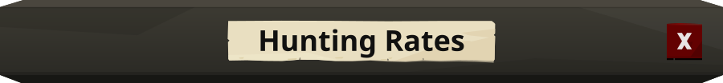
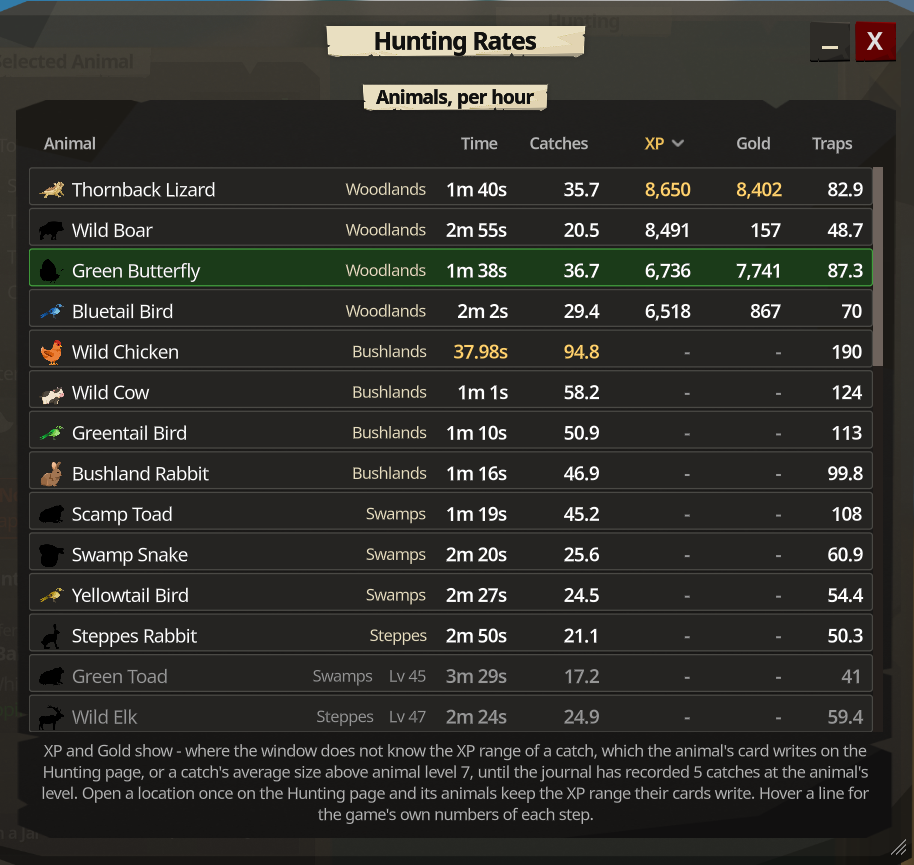
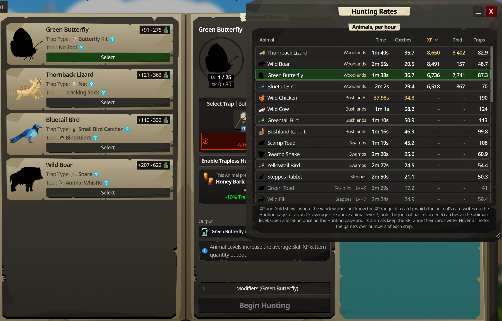
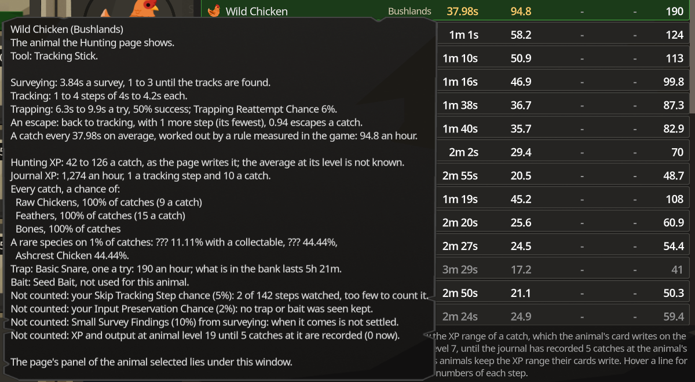

<h1 align="center"></h1>

  
  &nbsp;
  

> Where do I hunt for the most XP, catches or gold per hour?

Every animal has its own hunt: surveying until its tracks are found, a number of tracking steps, and a trap
that may fail and let the animal escape. Each step has its own time and chance, and the animal has its own
output, with a chance at a rare species. To compare them you would open the animals one by one and add up the
steps in your head. Hunting Rates puts them side by side: one line per animal, with the time of a catch and
what an hour there gives, from the game's own numbers. Click a line to open that animal on the Hunting page.

## Contents

- [Where it is](#where-it-is)
- [What the window shows](#what-the-window-shows)
- [The tooltip of a line](#the-tooltip-of-a-line)
- [What is counted](#what-is-counted)
- [Questions it answers](#questions-it-answers)
- [Good to know](#good-to-know)
- [When something is off](#when-something-is-off)
- [Install](#install)

## Where it is

On the Hunting page, a round button with the Hunting icon joins the others on the right edge of the screen.
Click it to open the window, and again, or the red X, to close it. On a window folded down to its title, the
button opens it up again. It is lit while the window is open and not folded.

The button is only there on the Hunting page. On any other page the window steps aside; back on the Hunting
page, it is there again as you left it, open or folded.

Until you move it, the window opens at the corner of the Hunting page where the most of its animals and
location buttons stay in sight beside it, then its panel of the animal selected; it may lie over the panel of
the hunt in progress. Drag the window to move it, drag its bottom right corner to resize it, or fold it down
to its title with the button beside the X. It is never larger than fits above the game's bottom bar, and a
list of more than 14 animals scrolls. Its place, size, fold and sort order are kept in `settings.json` in the
mod's folder, and what the Hunting page writes for each animal of each of your characters in `readings.json`
(see below).

## What the window shows

One line per animal the Hunting page can show you, in the order of the page (its locations, and in each its
animals): the animal's picture, its name, its location, and:

| Column | What it is |
| --- | --- |
| **Time** | How long one catch takes on average: surveying, tracking and trapping, escapes included. |
| **Catches** | Animals caught per hour. |
| **XP** | Hunting XP per hour. |
| **Gold** | What the output of an hour sells for, rare extras too, no collectable. |
| **Traps** | Traps taken from the bank per hour: one every try, preserved or not; none for an animal you hunt without a trap. |

- **A column shows `-` where the window cannot count it for that animal yet**, and a note under the list
  says why.
  - How many surveys a hunt takes is in no number of the game's: the Hunting page's panel works it out when it
    writes the surveying time of the animal selected. As soon as the Hunting page shows that panel, the window
    has the panel write it for every animal in turn, reads it, and has the panel write its own animal's again
    at once. Where that cannot be done (after a game update, or before any animal was ever selected there),
    every column is `-` until the panel has shown that animal: select it there once.
  - It is `-` for a trap whose bonuses change the chance after a failed try.
  - XP and Gold are `-` until the window knows how big a catch is on average (see
    [What is counted](#what-is-counted)): by the sizes the Hunting journal recorded for your last catches of
    that animal at its level now, or, at animal level 1 to 7, by the range its card writes (open its location
    once). The window keeps those sizes, the last 50 at the animal's level, in `readings.json`, so they are
    there from one game to the next. No number of the game's says how big a catch is on average at a level, so
    above level 7 an animal is `-` for XP and Gold until 5 of its catches at its level are recorded.
  - The window reads what the page writes whenever the Hunting page is on the screen, with the window open
    or not, and keeps it in `readings.json` for each of your characters, so a line keeps its numbers from one
    game to the next. The tooltip says "as the Hunting page last wrote it" for a number kept from an earlier
    game; the page writes it again whenever it shows that animal. The note under the list says in one line
    what fills the `-`, and each line's tooltip says it for that animal.
- **The best number of each column is gold**: the shortest time, the most catches, XP and gold. Traps has no
  best, since the fastest animal always uses the most.
- **Click a column's name to sort by it.** The first click puts the best animals on top, the next turns the
  order around. "Animal" goes back to the order of the page. The name the list is sorted by is gold, with the
  game's small arrow after it.
- **The animal the Hunting page shows**, the one selected in its panel, has the lit outline of a selected
  line, so it can be found in a sorted list. Select another animal on the page and the outline follows.
- **Click a line to go to that animal.** While you are not hunting, the Hunting page opens the animal's
  location and selects the animal through its own location button and the animal's own card, as your own two
  clicks there would, and its list scrolls until the card is in sight beside the window. When the page shows
  its journal, it shows the hunt again first, by its own button. Hunting is not started, and the window stays
  open. The pointer turns into a hand over a line a click takes somewhere.
- **While you hunt, a click selects nothing**, since selecting another animal might change the hunt in
  progress. It only shows: the hunt instead of the journal, and the animal's card when the page shows its
  location. The tooltip of a line a click cannot serve then says so.

- **An animal you cannot hunt yet is greyed**, with the Hunting level it needs (`Lv 40`), or `Locked` when it
  needs something else. A click on it opens its location only, and shows its card, where the page says what it
  needs; nothing while the location itself is locked. When the page keeps an animal's card from being
  selected, a click does not select it either, and its tooltip says so.
- **Animals and locations the game keeps hidden from you are not listed** until the game shows them.
- **An animal you have not discovered yet** gives nothing away: its line has its name as the Hunting page
  writes it (by the game's own word for something not found until the page has shown its location), its
  location and what it needs, no picture until the page draws one, and no numbers.
- **Each picture is drawn as the animal's card on the Hunting page last drew it**: where the card draws a
  black shape, so does the line. Until the page has drawn its picture, the line follows the rule the page was
  seen to keep on every card checked: a black shape for an animal the Hunting journal counts no catch of, in
  colour once it counts one. The colour is kept from game to game, and the page draws it again whenever it
  shows that card.
- **The game's setting for players who do not want to see spiders** is followed: with it on, a spider's line
  shows the picture the game shows instead, or none, never the spider.

## The tooltip of a line

Put the pointer on a line for the whole hour of that animal: how a hunt goes, what an hour brings, and what
is not counted. A line of the tooltip that would be longer than the screen allows goes on under it.

| Line | What it is |
| --- | --- |
| **Locked: ...** | What the animal is missing, in the game's own words. Only on a locked animal. |
| **The animal the Hunting page shows.** | Only on the line with the lit outline. |
| **The animal you are hunting now.** | Only while you hunt it. |
| **Tool: ...** | The tool the animal is tracked with, as its card on the page writes it once the page has shown it, or the page's own words for an animal that needs none. |
| **Surveying: 3.84s a survey, 1 to 3 until the tracks are found.** | The time of a survey with your bonuses, and how many a hunt takes, as the page writes it for this animal. Kept from an earlier game, it adds "as the Hunting page last wrote it". |
| **Tracking: 4 to 8 steps of 10s to 12.4s each.** | The number of steps and the time of one, with your bonuses. |
| **Trapping: 7.65s to 11.05s a try, 45% success; Trapping Reattempt Chance 6%.** | The time of a try of the trap and its chance, and the chance to try again, by the page's name for it. |
| **An escape: back to tracking, with 4 more steps (its fewest), 1.15 escapes a catch.** | Where an escape takes you, how many steps it adds (the animal's fewest), and how many escapes a catch takes. |
| **A catch every 2m 27s on average, worked out by a rule measured in the game: 24.5 an hour.** | The time of a catch and the catches of an hour; where they cannot be counted, what the window does not know. |
| **Hunting XP: 11,433 an hour, 467 a catch on average, of 233 to 700 on its card.** | The XP of a catch on average, and of an hour, beside the range the animal's card writes. The range and the XP of a catch are rounded down, as the card writes them ("+233 - 700"). Kept from an earlier game, it adds "as the Hunting page last wrote it". Where the average is not known, the range alone. |
| **By the sizes the journal recorded for your last 31 catches at animal level 19: 1.11 times its XP on average; 24 of them were kept from earlier games.** | What a catch's XP and output rest on: the sizes the Hunting journal recorded for your last catches of that animal at its level now, up to 50, kept by the window from one game to the next; or, without 5 of them, "The middle of its range" at animal level 1 to 7, where it was measured. |
| **Journal XP: 504 an hour, 1 a tracking step and 10 a catch.** | The animal's journal XP, and of an hour. |
| **Every catch, a chance of:** | The animal's output with the chance of each item, how many it brings, and how many an hour. |
| **The doubling chance (2%) is counted in the output.** | Your doubling chance, in the output of an hour and its gold. |
| **A rare species on 1% of catches: ...** | Each species in one line, with its share of the rare ones, "(locked)" for one that cannot come yet, and what it brings besides. A species you have never trapped and a collectable you have never found are not named, as the journal does. |
| **Trap:** and **Bait:** | The trap selected for the animal, or that you hunt it without one; its bait, and whether you use it. Each with an hour of it and how long what is in the bank lasts. |
| **Gold: 1,497 an hour, what the output sells for.** | What an hour's output sells for in gold; where an hour cannot be counted, what one catch's output sells for. |
| **Not counted: your Skip Tracking Step chance (5%): 2 of 142 steps watched, too few to count it.** | What the hour leaves out, each in one line: the chance to skip a step, the preservation chance, what surveying can find, XP and output where what they rest on is not known (5 catches at the animal's level above level 7, its card's XP range at level 1 to 7, or the animal's level), each with what fills it, and a hunt without a trap. |
| **Click to open this animal on the Hunting page. Hunting is not started.** | What a click on the line does; on a locked animal, which location it opens; while you hunt, that it only shows. When a click cannot serve the line: why (a hunt runs, the page does not let the animal be selected, or the page has no room for its card beside the window), and when the page's panel of the animal selected lies under the window. |

An animal not discovered yet has only its name, its location, what it needs, and what a click does.

## What is counted

The numbers start from the game's own values for each animal, the ones the Hunting page's panel shows for the
animal selected there: the time of a survey, the steps of tracking and the time of one, the time and chance of
a try of the trap, the chance to try again, the XP, the output and its chances, the chance of a rare species
and the weights of the species, their extra products, and the doubling and preservation chances. Whatever
changes the game's numbers changes the window's too.

How these join into a catch is in no number of the game's. It was measured on a character's own hunting, 15
minutes of Yellowtail Bird (62 tracking steps, 13 tries of the trap, 7 escapes and 6 catches) and 15 minutes
of Wild Chicken at animal level 18 (80 tracking steps, 50 tries, 24 escapes and 24 catches). A hunt without a
trap was never watched: it is counted as one with a trap, and its tooltip says so.

| Rule | Where it comes from |
| --- | --- |
| A hunt starts with surveys until the tracks are found, as many as the middle of the range the page writes for surveying ("3.84s - 11.52s" is one to three surveys: two). | The game's own words, and the window's middle of the range. No number of the game's gives it: the window has the page's panel write it for every animal, as the panel writes it for the animal selected, and an animal it could not be written for shows `-`. The window keeps it from game to game. Measured: 2, 1, 2, 3, 1 and 1 surveys, never more than three. |
| Then tracking: every step takes one tracking interval and moves on by one; no step fails. | Measured: 62 of 62 steps of Yellowtail Bird, 78 of 80 of Wild Chicken. The tracking chance does not make a step fail. |
| The chance to skip a tracking step is not counted. | Measured: no step skipped in 62 of Yellowtail Bird (about 3 expected); 2 of 80 of Wild Chicken moved on two steps (4 expected). Too few to count how it shortens a hunt. |
| Every number of steps in the game's range is as likely, and every time in a range: the window takes the middle of each. | The window's own, as Fishing Rates takes the middle of a catch time. |
| Then a try of the trap, which catches at the trapping chance. | The game's chance. Measured: 6 of 13 tries caught on Yellowtail Bird, 24 of 50 on Wild Chicken. |
| A failed try is tried again at the reattempt chance; otherwise the animal escapes. | The game's own words: "The chance to reattempt a trapping action when it fails". Measured: 7 of 7 failed tries escaped on Yellowtail Bird (0.4 tries again expected); on Wild Chicken 2 of 26 were tried again (1.56 expected). |
| An escape takes you back to tracking, never to surveying, with more steps to go, then another try. | Measured: 7 of 7 escapes of Yellowtail Bird, 24 of 24 of Wild Chicken. |
| An escape adds the animal's fewest steps, with your bonuses. | Measured: each of 7 escapes of Yellowtail Bird added 4 (its steps 4 to 8), each of 24 of Wild Chicken added 1 (its steps 1 to 4). No other of the animal's numbers fits both. |
| A catch ends the hunt, and the next starts with surveying. | Measured: 6 of 6 catches. |
| The chances of a try count as they are now. A trap whose bonuses change the chance after a failed try is not counted. | The window's own: what those bonuses do is not known yet. |
| Every try takes one trap and one bait from the bank, whether it catches or not, preserved or not. Your Input Preservation Chance is not counted. | Measured: 13 tries took 13 traps and 13 Seed Bait, and none was kept. Fishing Rates measured that a preserved bait is still taken from the bank. The bait of a hunt without a trap is not counted: it was not measured. |
| Hunting XP comes with a catch only: the animal's XP times the catch's size, the size the Hunting journal records for that catch. | Measured: XP on 6 of 6 catches of Yellowtail Bird and with nothing else; on Wild Chicken a catch's XP was the animal's XP times the size the journal recorded on 24 of 24 catches. |
| A catch is counted by the average of the sizes the journal recorded for your last catches of that animal at its level now, when there are 5 or more. The window keeps the last 50 at the animal's level from one game to the next; a level-up starts them anew, and a catch that brought a level-up is left out. Otherwise, at animal level 1 to 7, by the middle of the range the animal's card writes; above that, or when the animal's level is not known, XP and Gold show `-`. | The game's own words: "Animal Levels increase the average Skill XP & Item quantity output." No number of the game's says how a size is drawn at a level. Measured: Yellowtail Bird's 6 catches at an animal level from 1 to 7 averaged the middle (1.001); Wild Chicken's 24 at level 18 averaged 1.11 times the animal's XP, where the middle does not hold. |
| The journal XP is the animal's base: for every tracking step and for every catch. | Measured: 1 on each of 62 steps and 10 on each of 6 catches, the game's base values for Yellowtail Bird. |
| The output comes with a catch, each item at its chance: its quantity times the catch's size, rounded down and at least one. The doubling chance doubles each item on its own, not the rare extras. | Measured: the output came on 6 of 6 catches of Yellowtail Bird and at no other time; on Wild Chicken each item followed the size so on 23 of 24 catches (one Raw Chicken of 17 is not explained), and items were doubled one at a time. The doubling is the window's reading of the game's words for it, "Your chance to double the output". |
| What a survey can find is not counted. | When a find comes is not settled: none came in 10 surveys of Yellowtail Bird (1 expected); 5 came in 43 of Wild Chicken, which fits a chance on every survey and once a hunt alike. |
| A rare species' extra product comes at the chance of a rare species, of that species among the rare ones, and of the product. A species still locked brings nothing. | The game's chances; the window's reading of how they join and of the lock. |
| Chances count as their long-run average. | The window's own. |
| Gold is what the items sell for in gold. A collectable is not counted. | The game's sell prices. |

## Questions it answers

- **Where do I get the most Hunting XP an hour?** Sort by XP.
- **Which animal is the quickest to catch?** Sort by Time.
- **How long do my traps and bait last?** The trap and bait lines of the tooltip.
- **What does each animal ask of me?** Its tooltip: the time of every step, its chance, its tool, trap and
  bait.
- **Where are the rare ones?** The rare species line of the tooltip, with the share of each.

## Good to know

- It is an estimate, not a promise: chances average out over many hunts, not over ten. An escape costs
  several steps, so one hunt can take twice as long as the next.
- The way the steps of a hunt join was measured on two animals, Yellowtail Bird and Wild Chicken. Where a
  number is not known, the columns show `-` rather than a guess.
- Hunting has no mastery XP in this game (its Mastery Guild counts tasks), so there is no column for it. An
  animal's journal XP is in the tooltip.
- Gold is not profit: traps and bait are not taken off.
- `readings.json` holds only what the Hunting page wrote and the sizes the journal recorded for your catches,
  never anything of your save. Deleting it only brings back the `-` until the page shows those animals again,
  and until 5 more catches of an animal above level 7 are recorded.
- The window starts nothing. While you are not hunting, a click on a line changes which location and animal
  the Hunting page selects, through the page's own buttons; while you hunt, it selects nothing. It also shows
  the hunt instead of the journal. Hunting, traps, bait and hunting without a trap are left as they are.

## When something is off

| You see | What it means |
| --- | --- |
| No round button on the Hunting page | It comes a moment after the page opens. If it never comes, look for `[HuntingRates]` in `MelvorModLoader.log`: "the widget strip was not found" means a game update changed the screen. |
| `-` on most lines | The window could not have the Hunting page's panel write how many surveys a hunt takes yet. Select any animal on the Hunting page: the window then has the panel write it for the others. If the `-` stays, the game was updated and `MelvorModLoader.log` has one `[HuntingRates]` line about the panel; select each animal there once instead. |
| `-` for XP and Gold only, with "a catch's average size" in the note | The animal is above level 7 and fewer than 5 of its catches at its level have been recorded while the mod was installed: hunt it a little, and the window counts by the sizes the journal records, and keeps them for the next game. |
| `-` on a line, with "how many surveys a hunt takes" in the note | Select that animal on the Hunting page once: its panel writes how many surveys a hunt takes, which the window reads and keeps. |
| "before the range its card writes, not shown on the page yet", or "until its card shows its XP range" | Open that animal's location on the Hunting page once: the window reads the range on its card and keeps it. |
| "as the Hunting page last wrote it" | The number was read in an earlier game and kept in `readings.json`. The window reads it again whenever the page shows that animal; if your bonuses changed since, select the animal once. |
| A line without a picture | The game has no picture for that animal yet, only its grey stand-in; the animal is not discovered yet; or the spider setting is on and the page has not shown its own picture for a spider yet. |
| A click on a line does nothing while you hunt | As meant: while a hunt runs, a click selects nothing. |
| A click on a line opens nothing at all | `MelvorModLoader.log` says "A click on a line opens nothing from now on", or that a page button "did not" do what its click does: a game update changed the Hunting page. |
| No button and no window at all | Look for `[HuntingRates] Stopped` in `MelvorModLoader.log`: the mod switched itself off after a game update. |

## Install

Get the zip from <a href="https://github.com/Springs-Tea/melvor-idle-2-qol-mods/releases">Releases</a>.

1. Install the [Melvor Mod Loader](https://www.nexusmods.com/melvoridle2/mods/2) (0.1.3 or newer).
2. Open the game folder: Steam > right-click Melvor Idle 2 > Manage > Browse local files.
3. Extract the mod's zip there, so the file ends up as `mods\HuntingRates\HuntingRates.dll`.
4. Start the game. `MelvorModLoader.log` in the game folder has a line `Mod loaded: HuntingRates`.

To update, extract the new zip over the old one. To remove the mod, delete `mods\HuntingRates`. Your save is
never changed.
