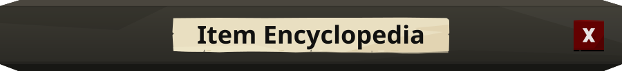
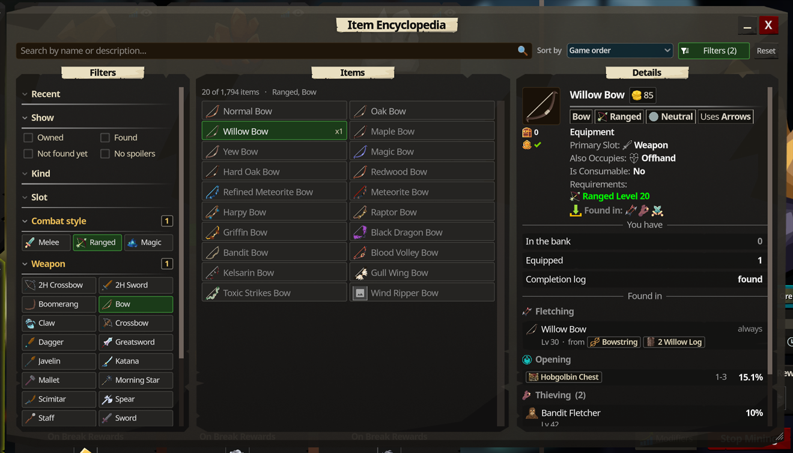
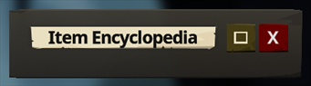
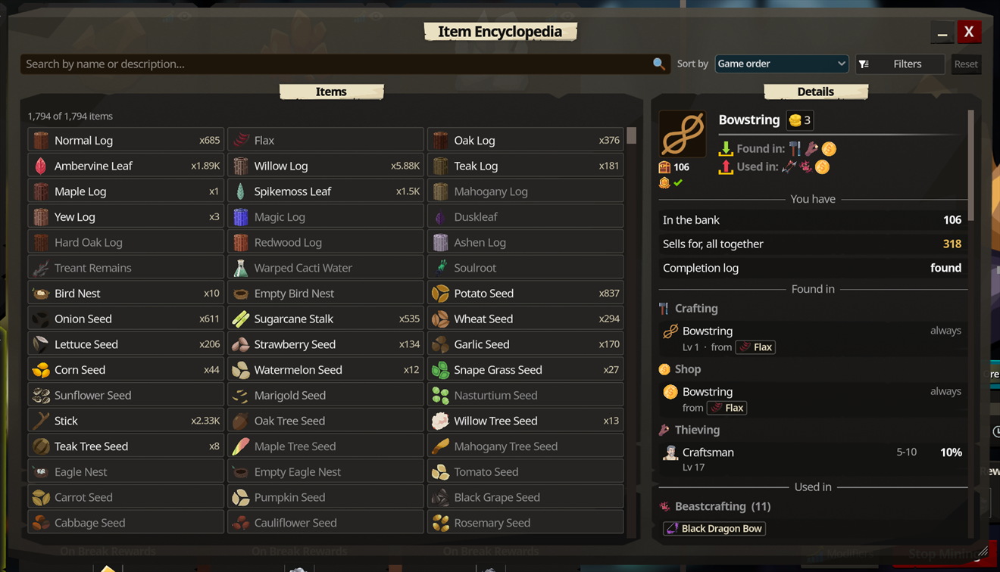
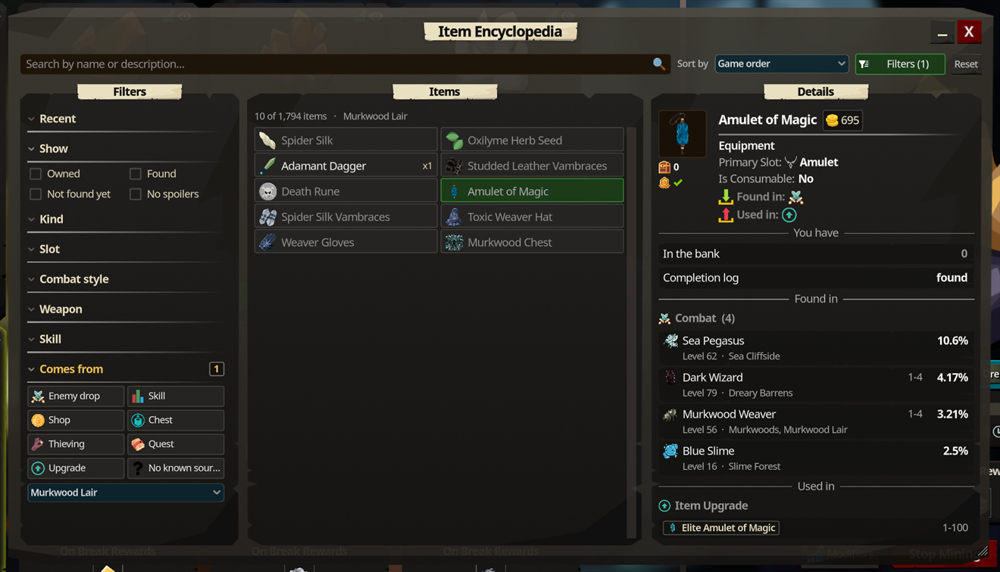

<h1 align="center"></h1>

  
  &nbsp;
  

> What is this item, what is it good for, and where do I get it?

Every item of the game in one window. Search it by name, narrow it down by kind, slot, combat style, weapon,
skill or where it comes from, and read everything about the item you pick: what it does, what it takes to
use it, how many you have, which enemy drops it and how likely, what it is made from, and what it is used
in. It only shows what the game's own data says. It never gives, buys or equips anything.

## Contents

- [Opening it](#opening-it)
- [The list](#the-list)
- [The filters](#the-filters)
- [Combining them](#combining-them)
- [The details](#the-details)
- [No spoilers](#no-spoilers)
- [How it works](#how-it-works)
- [Good to know](#good-to-know)
- [When something is off](#when-something-is-off)

## Opening it

Press **F9**, or the round button with the book in the strip of round buttons on the right edge of the
screen, where the game has its own tool belt and events buttons. The same key or button closes it again,
and so does the red X. The game does not show that strip in the bank and in the shop: there, F9 is the way.

Drag the window from any empty spot. Drag the lines in its bottom right corner to make it larger or smaller;
it is drawn again at that size, so the text stays sharp. Its place, its size, your filters, the sort order
and the item you were looking at are all there again next time.

**To put it aside without closing it**, press the small button beside the X. The window folds down to its
title, which you can drag wherever it is out of the way. The same button, or F9, opens it again where the
title is, with everything as you left it.

## The list

With nothing typed and nothing ticked, the list is every item, in the order of the game's completion log.
The line above it says how many items match and which filters are on.

| You see | It means |
| --- | --- |
| A name in white, with `x685` or `x5.88K` | You have it: that many in the bank and equipped together, written as the bank writes it. |
| A name in grey | You have had it before, and have none now. |
| A dim name | You have never found it. |
| `???` and a dark shape | "No spoilers" is on and you have not found it yet. |

- **Search** looks in names and descriptions. Several words must all be there: `rune arrow`.
- **Sort by** the game's order, the name, the level it asks for to wear or use, what it sells for, or how
  many you own. With level or price chosen, the number at the end of a line is that level or price.
- The mouse wheel moves the list. Click a line to read about the item on the right.

## The filters

**Filters** opens them on the left; press it again and they are out of the way, with the list one column
wider. **Reset** clears the search and every filter. A heading folds its group away and shows how many of
its choices are ticked.

| Group | What it narrows to |
| --- | --- |
| **Recent** | Your last five searches and filter choices, one click away. See below. |
| **Show** | *Owned*: what is in your bank or equipped now. *Found*: what the completion log has. *Not found yet*: what it is still missing. |
| **Kind** | Weapon, Armour, Jewellery, Ammo, Food, Chest (anything that is opened), Bones, Hunting Trap, Fishing Bait, Compost, Skilling outfit, the tool belt's own categories (Tool, Potion, Catalyst, Utility Item...) and Material: ores, logs, bars, runes, seeds and everything else that is only made, sold or spent. |
| **Slot** | Where it is worn: Weapon, Offhand, Helmet, Torso, Legs, Boots, Gloves, Cape, Amulet, Ring, Ammo. A skilling outfit's hat counts as a Helmet. |
| **Combat style** | Melee, Ranged or Magic: the fighter it is for. |
| **Weapon** | The kind of weapon: Bow, Sword, Staff, Crossbow, Dagger and the rest. |
| **Skill** | The skills as the game's own "Found in" and "Used in" icons have them, Combat, Shop and Quests among them. *Gives it*, *Uses it* and *Tools* say which side you mean; *Any* is all three. |
| **Comes from** | Enemy drop, Skill, Shop, Chest, Thieving, Quest, Upgrade, or No known source. Under them, one area or dungeon: only what its enemies drop or it gives as its reward. |

Inside a group, ticking two choices means either of them. Across groups, an item has to fit all of them.

On top of the filters is **Recent**: the last five different things you asked, a search, a set of filters or
both, newest first. Click one and the list is back to it. A question is kept once you have done something
with its result: opened an item, pressed Reset, or put the window away. The steps on the way to it are not.

## Combining them

- **Everything to do with Cooking**: Skill > Cooking. Only what it makes: *Gives it*. Only its ingredients:
  *Uses it*. The skillet and the gloves that help: *Tools*.
- **The loot of a dungeon**: Comes from > the list of areas > the dungeon's name.
- **Body armour for a ranger**: Combat style > Ranged, Slot > Torso.
- **Every bow**: Weapon > Bow. With Sort by > Level, in the order you can wield them.
- **A warrior's weapons**: Combat style > Melee, Kind > Weapon.
- **What am I still missing from the Slime Forest?** Show > Not found yet, Comes from > Slime Forest.
- **What can I sell?** Show > Owned, Sort by > Sell price.

## The details

On top is the game's own item panel, the one of the bank and of every tooltip: picture, name, price, what
kind of thing it is, its stats and bonuses, what it asks for and whether you meet it, in the game's words
and numbers. Under it:

- **You have**: how many are in the bank, how many are equipped (worn, or on a skill's tool belt), what the
  lot sells for, and whether the completion log has it.
- **Found in**: every place it comes from, under the skill or kind of place. An enemy with its level, the
  areas it lives in, how many it drops and the chance per kill. A recipe with the level it asks for and
  what it is made from. A chest, a thieving target, a shop purchase with its price, a quest.
- **Used in**: every recipe, upgrade and purchase that takes it, how many, and what comes out.

Every item named in there, an ingredient, a product, a chest, is a small tag with its picture. Click it and
you are on that item's page. **Back** takes you to where you came from, as many steps as you went.

A long group shows its first thirty lines and a button, **Show all**, for the rest: a rune is used in
hundreds of recipes.

## No spoilers

Show > **No spoilers** keeps what you have not found yet a secret: those items stay in the list as `???`
with a dark shape, their details are withheld, and they cannot be searched by name. The filters still work
on them, so "three ranged body armours I have not found" is something you can see without being told which.

## How it works

Nothing is typed in by hand, so items a game update adds show up by themselves.

- **The list** is the game's item registry, without the few items the game itself keeps out of its
  completion log (bare fists, unfinished things).
- **Kind, slot and weapon** come from what the game says an item can do: be worn, be a weapon, be eaten,
  go on a tool belt, be opened, be buried.
- **Combat style** has no field in the game, so it is worked out. A weapon belongs to the styles of its
  attack stances, ammunition to the weapons that shoot it. Anything else worn belongs to the style whose
  own level it asks for (Magic for a wizard's robe); failing that, to the styles whose accuracy it raises;
  failing that, to the styles it does not hold back (leather takes accuracy from melee and magic, so it is
  ranged). What favours nobody is under no style.
- **Skill** is the game's own tagging, the icons after "Found in" and "Used in". *Tools* are the items that
  fit a tool belt slot of that skill.
- **Where it comes from** is read the way [Item Sources](../ItemSources) reads it: every piece of the
  game's content is walked once, beside the game, the first time the window is opened. That takes about a
  tenth of a second.

## Good to know

- The chances are the base ones from the game's drop tables. Bonuses to drop chance or doubling are not
  applied.
- An area or dungeon is in the list of "Comes from" when at least one item drops there.
- What you own is read again every second or two while the window is open, so loot shows up as it arrives.
- The settings are in `settings.json` in the mod's folder. Deleting the folder removes everything.

## When something is off

| You see | What it means |
| --- | --- |
| "Reading the game's data..." | The first moment after the window was first opened. The list is there already; where things come from follows. |
| "No item matches." | The filters and the search together leave nothing. Press Reset. |
| "Nothing in the game's data gives this item." | No source is recorded in the game's content: a starting item, or something not obtainable yet. |
| A plain header instead of the game's item panel | A game update changed that panel. The log says so; the rest still works. |
| No round button | A game update moved the strip it sits in. The log says so; F9 still opens the window. |
| "Stopped (the game was updated?)" in the log | Something the mod needs is gone. It has switched itself off; the game and your other mods keep running. |

## Install

Get the zip from <a href="https://github.com/Springs-Tea/melvor-idle-2-qol-mods/releases">Releases</a>.

1. Install the [Melvor Mod Loader](https://www.nexusmods.com/melvoridle2/mods/2) (0.1.3 or newer).
2. Open the game folder: Steam > right-click Melvor Idle 2 > Manage > Browse local files.
3. Extract the mod's zip there, so the file ends up as `mods\ItemEncyclopedia\ItemEncyclopedia.dll`.
4. Start the game. `MelvorModLoader.log` in the game folder has a line `Mod loaded: ItemEncyclopedia`.

To update, extract the new zip over the old one. To remove the mod, delete `mods\ItemEncyclopedia`.
Your save is never changed.
