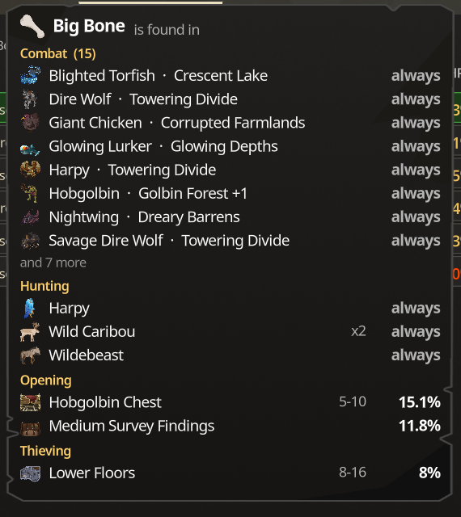
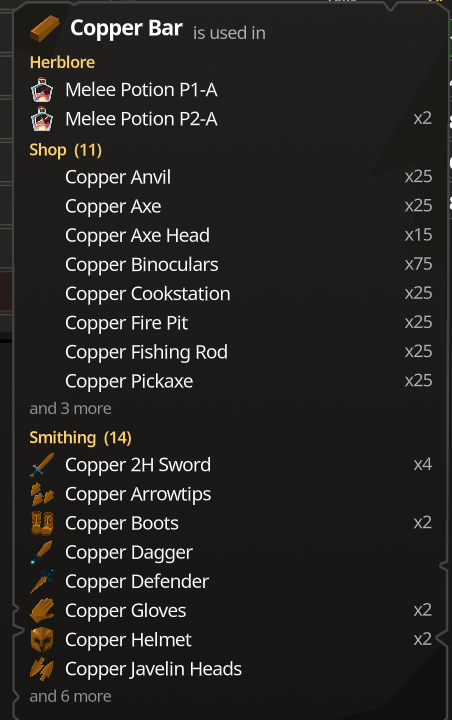
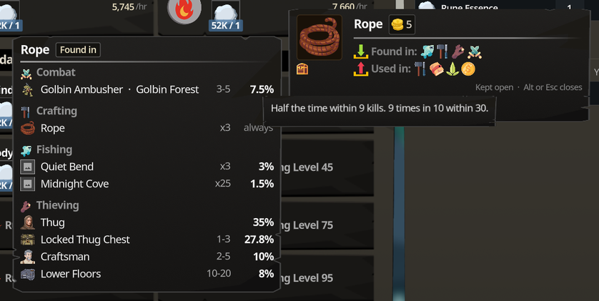
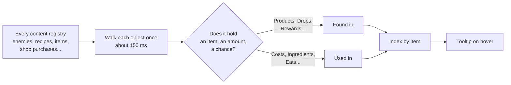

<h1 align="center"></h1>

  
  &nbsp;
  
  &nbsp;
  

> Where does this drop, and what is it for?

  
  &nbsp;
  

The game's item panel says "Found in" and "Used in" and shows a few skill icons. Item Sources tells you what
is behind them: which enemy, in which area, how many and how likely; which recipe, chest, thieving target or
shop purchase. It works in the bank, and on any item's tooltip anywhere in the game.

## Contents

- [In the bank](#in-the-bank)
- [Anywhere else: Alt](#anywhere-else-alt)
- [Reading the list](#reading-the-list)
- [Questions it answers](#questions-it-answers)
- [How it works](#how-it-works)
- [Good to know](#good-to-know)
- [When something is off](#when-something-is-off)

## In the bank

Select an item. In the panel on the right, under its description, are the two rows "Found in" and "Used in".
Put the pointer on either row: the list opens beside the panel and closes when you move away. Nothing to
click, nothing to set up.

The list of "Found in" also stays open while you move onto it, to rest the pointer on a chance: see
[Reading the list](#reading-the-list).

## Anywhere else: Alt

Wherever the pointer is on an item, the game shows the same small tooltip: on a recipe's materials, in a
shop, on loot, on equipment. It follows the pointer, so its two rows cannot be reached.

1. Point at the item, so its tooltip is up.
2. Press and let go of **Alt**. A copy of the tooltip stays where it is.
3. Move onto its "Found in" or "Used in" row. They work like the ones in the bank.
4. **Alt** again, **Esc**, or a click somewhere else closes it. Alt on another item moves it there.

So while you look at a recipe: point at the material you are short of, press Alt, and see where it comes
from. The game's tooltip gets one quiet line at its foot, "Alt: keep this open", as a reminder.

Alt together with another key (Alt+Tab, Alt+Enter) is not this key, and neither is AltGr.

## Reading the list

Lines are grouped by where the item comes from or goes to. Combat is always first; inside a group the
likeliest source is on top.

| You see | It means |
| --- | --- |
| **Combat** | An enemy drops it, or a dungeon gives it as its reward. After the enemy's name is the area it lives in; `+1` means one more area has it too. |
| **A skill's name** (Thieving, Hunting, Smithing...) | A target, an animal or a recipe of that skill gives or uses it. The line is that target or recipe. |
| **Opening** | It is inside a chest or another openable item. |
| **Shop**, **Quests**, **Upgrading** | A shop purchase, a quest reward, an item upgrade. |
| `1-5` or `x2` in the middle | How many at a time: a range, or a fixed number. Nothing there means one. |
| `6.41%`, `1 in 2,000`, `always` on the right | The chance each time (per kill, per pick, per chest). The column is only there when something in the list is not certain. |
| `Combat  (15)` | The group has fifteen lines; the first eight are shown, then "and 7 more". |

**What a chance means in kills.** Move the pointer from "Found in" onto its list and rest it on a chance.
A small tooltip says how long that usually takes:

- "Half the time within 9 kills": of everyone who goes for it, half have the item after 9 kills or fewer.
- "9 times in 10 within 30": nine in ten have it after 30. One in ten is still waiting.
- It counts kills for an enemy and tries for everything else: a pick, a chest, a catch. `always` has nothing
  to add, and a chance of a half or better only gets the second sentence.

The list stays open while the pointer is on it and on its way there, also when it crosses "Used in" on
that way. It closes when you stop half way, or move somewhere else. This works in the bank and on a tooltip
kept open with Alt. The game's own tooltip follows the pointer, so its list cannot be reached: press Alt.

"Used in" reads the same way, with the amount the recipe or purchase takes.

## Questions it answers

- **Where do I farm this?** Found in > Combat: enemy, area, chance. Compare the chances and pick.
- **What needs this material?** Used in. Useful before you sell a pile of something.
- **Can I buy it?** If a shop sells it, there is a Shop line.
- **Which chest has it?** Found in > Opening names the chest and the chance per chest.

## How it works

The game keeps this knowledge spread over its content: an enemy's drop tables, a recipe's products and
ingredients, a thieving target's loot, what a chest holds. Rather than know each of those by name, the mod
walks every content registry once when a character is opened.

- Chances are worked out from the game's own drop tables: the table's chance times the item's weight in it.
- Because nothing is hard-coded, items and enemies a game update adds show up by themselves.
- The tooltip that Alt keeps open is a second copy of the game's own item panel, on the game's own card, so
  it looks and reads exactly like the original.

## Good to know

- The chances are the base ones from the game's data. Bonuses to drop chance or doubling are not applied.
- A few relations are left out on purpose, because they neither give nor take the item: quest steps and
  Mastery Guild tasks that only ask you to have it, and the pieces of an equipment set.
- The mod has no settings and writes no files.

## When something is off

| You see | What it means |
| --- | --- |
| "Reading the game's data..." | The first second after a character is opened. Move away and back. |
| "Nothing in the game's data gives this item." | No source is recorded in the game's content: a starting item, or something not obtainable yet. |
| "The game's data could not be read" | A game update changed the content in a way the mod cannot walk. The log says where; the mod needs an update. |
| Alt does nothing | The item's tooltip must be up when you let go of Alt. If the log says "Keeping a tooltip open with Alt is switched off", a game update changed the item panel; the bank rows still work. |

## Install

Get the zip from <a href="https://github.com/Springs-Tea/melvor-idle-2-qol-mods/releases">Releases</a>, or from <a href="https://www.nexusmods.com/melvoridle2/mods/18">the mod's page on Nexus Mods</a> if you prefer.

1. Install the [Melvor Mod Loader](https://www.nexusmods.com/melvoridle2/mods/2) (0.1.3 or newer).
2. Open the game folder: Steam > right-click Melvor Idle 2 > Manage > Browse local files.
3. Extract the mod's zip there, so the file ends up as `mods\ItemSources\ItemSources.dll`.
4. Start the game. `MelvorModLoader.log` in the game folder has a line `Mod loaded: ItemSources`.

To update, extract the new zip over the old one. To remove the mod, delete `mods\ItemSources`.
Your save is never changed.
