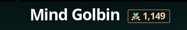

<h1 align="center"></h1>

<a href="../../README.md">All mods</a> · <a href="https://github.com/Springs-Tea/melvor-2-mods/releases">Download</a>

> How many of these have I killed?

Shows how many times you have killed the enemy you are fighting, in a small tag next to its name on the
combat screen. Hover the tag for the sentence.

The number is the game's own statistic (the one the Completion Log counts with), so it is right after
offline progress too.

## Install

1. Install the [Melvor Mod Loader](https://www.nexusmods.com/melvoridle2/mods/2).
2. Extract the mod's zip into the game folder, so the file ends up as
   `mods\KillsInCombat\KillsInCombat.dll`.

To remove it, delete `mods\KillsInCombat`. Your save is never changed.
