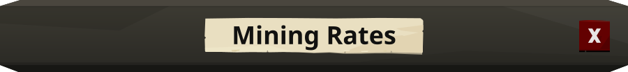
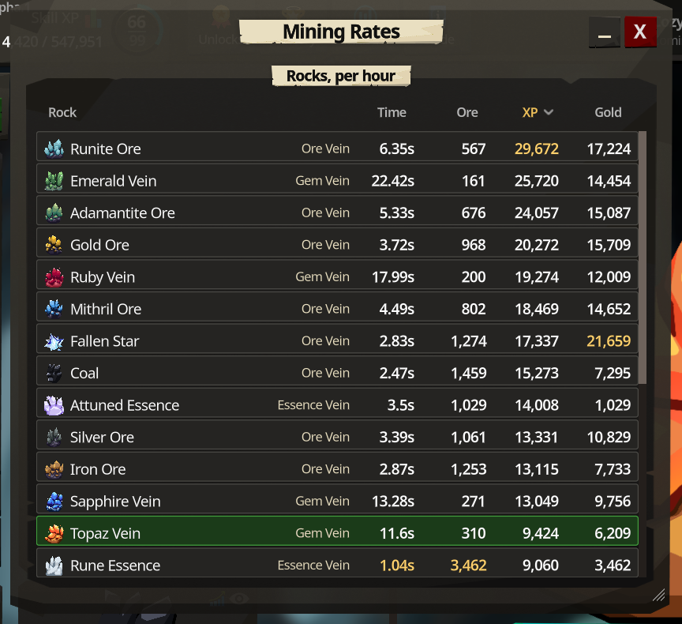
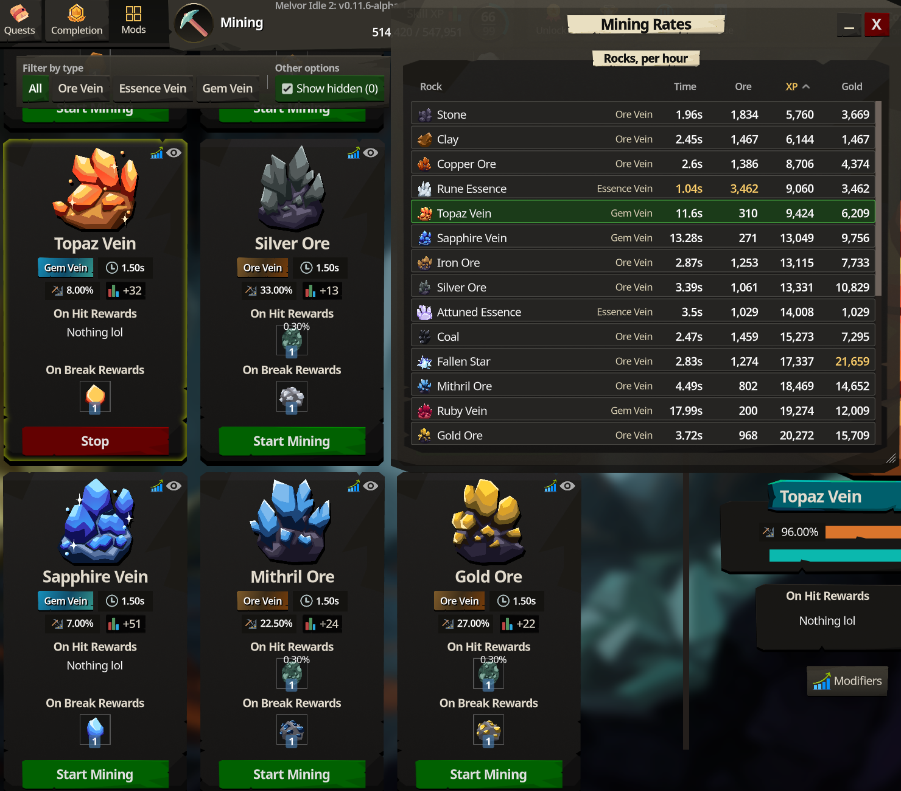
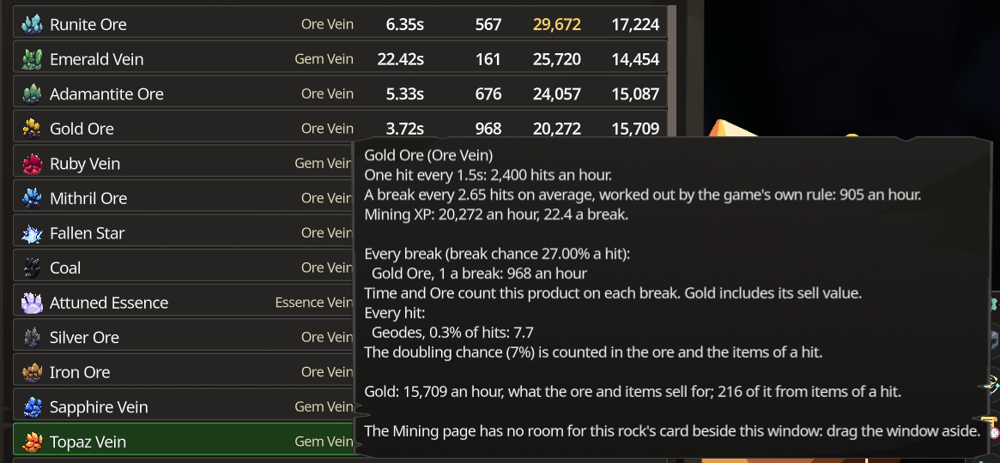

<h1 align="center"></h1>

  
  &nbsp;
  

> Where do I mine for the most XP, ore or gold per hour?

On the Mining page, the rates window shows one line per rock. Compare the time for one ore and the ore,
Mining XP and gold per hour at each rock. A rock that takes more hits to break gives its XP less often.
Hover a line for the whole hour, or click it to see that rock on the Mining page.

## Contents

- [Where it is](#where-it-is)
- [What the window shows](#what-the-window-shows)
- [The tooltip of a line](#the-tooltip-of-a-line)
- [What is counted](#what-is-counted)
- [Questions it answers](#questions-it-answers)
- [Good to know](#good-to-know)
- [When something is off](#when-something-is-off)

## Where it is

On the Mining page, a round button with the Mining icon joins the others on the right edge of the screen.
Click it to open the window, and again, or the red X, to close it. On a window folded down to its title, the
button opens it up again. It is lit while the window is open and not folded.

On first opening, the window leaves room for as many rock cards as possible, then for the active rock and
category filter. A position you save by dragging takes precedence.

The button is only there on the Mining page. On any other page the window steps aside; back on the Mining
page, it is there again as you left it, open or folded.

Drag the window to move it, drag its bottom right corner to resize it, or fold it down to its title with the
button beside the X. It is never larger than fits above the game's bottom bar, and a list of more than 14
rocks scrolls. Its place, size, fold and sort order are kept in `settings.json` in the mod's folder.

## What the window shows

One line per rock the Mining page shows you, in the order of the page: the rock's picture, its name, its
category, and:

| Column | What it is |
| --- | --- |
| **Time** | How long one ore takes, with your bonuses and the hits a break takes counted in. |
| **Ore** | Estimated ore per hour, including any of the same item listed on hit. |
| **XP** | Mining XP per hour, counted once per break. |
| **Gold** | What the ore and the other items of an hour sell for. |

- **The best number of each column is gold**: the shortest time and the most ore, XP and gold.
- **Click a column's name to sort by it.** The first click puts the best rocks on top, the next turns the
  order around. "Rock" goes back to the order of the page. The name the list is sorted by is gold, with the
  game's small arrow after it. The Time, Ore and Gold tips give the Topaz Vein bank counts.
- **The rock the Mining page shows** in its big panel, the one you are mining, has the lit outline of a
  selected line, so it can be found in a sorted list.
- **Click a line to see that rock on the Mining page**: when the page's category filter is on another
  category, it goes to the rock's category, as the page's own category button does, and the page's list of
  rocks scrolls until the rock's whole card is in sight beside the window, above or below it when the window
  lies across the card's column. Mining is not started or stopped, and the window stays open where it is.
  The pointer turns into a hand over a line a click changes something for, the rock you are mining included
  when its card is out of sight; on a rock whose card is in sight beside the window already, a click does
  nothing.
- **When the page has no room for a card beside the window**, the line's tooltip says so, and a click does
  not scroll to it: drag the window aside, off the rocks' cards. The card of a rock of another category is
  measured once its category is shown: a click on its line changes the filter, and from then on its tooltip
  says when there is no room.

- **A rock you cannot mine yet is greyed**, with the Mining level it needs (`Lv 40`), or `Locked` when it
  needs something else. Its numbers come from the game's own values for it like the others, and it is never
  marked best. In a list sorted by a number, the locked rocks come last.
- Rocks the game keeps hidden from you are not listed until the game shows them. A rock you hid yourself on
  the Mining page is listed only while the page lists hidden rocks too, so the window lists the rocks the
  page does.

## The tooltip of a line

Put the pointer on a line for the whole hour at that rock:

| Line | What it is |
| --- | --- |
| **Rock name (category)** | The first line gives the rock's name and, when the game supplies it, its category. |
| **Locked** or **Locked: ...** | A locked rock shows its missing requirement when the game gives one. |
| **You hid this rock on the Mining page.** | Only on a rock you hid yourself. |
| **The rock the Mining page shows.** | Only on the line with the lit outline. |
| **The game gives no time for a hit on this rock yet.** | Without a hit time, the tooltip skips the hourly figures. |
| **One hit every 1.5s: 2,400 hits an hour.** | The game's time of a hit for the rock, with your bonuses. |
| **A break every 1.85 hits on average, worked out by the game's own rule: 1,296 an hour.** | How many hits a break takes, from the rock's break chance (see [What is counted](#what-is-counted)), and the breaks of an hour. |
| **A break every hit: 2,400 an hour.** | When one hit always breaks this rock, breaks per hour equal hits per hour. |
| **There is no usable break chance for this rock.** | The game gives no positive, finite chance. |
| **There is no usable minimum break bar for this rock.** or **The minimum break bar reads ...** | The game gives no finite minimum, or gives a value outside the range from 0 to under 1. |
| **This rock has no listed break product with a positive quantity.** | The rock has no break product, or gives none of it. |
| **The window cannot count XP, ore, time per ore or gold for this rock (-).** | The line above says why. |
| **Your minimum break bar (10%) is counted as where the bar starts.** | When the window uses your minimum to count the hits a break takes. |
| **Mining XP** | XP per break and per hour. The XP column's tip names the rocks where this was measured. |
| **Every break (break chance 45.00% a hit)**, and a line for the product | The current chance on the rock's card, even above 100%. The next line gives the product, its listed quantity per break and its estimated total from breaks per hour. |
| **Time and Ore count this product on each break. Gold includes its sell value.** | How the listed break product contributes to the columns. |
| **On Topaz Vein, the bank gained one gem on 82 breaks and two on 10 (1.109 per break).** | Only on gem veins with a counted break product. The counts were measured on Topaz. |
| **Every hit**, and a line per item | Each item a hit can bring, with its chance per hit, how many a hit brings when it is more than one, and how many an hour brings. |
| **The doubling chance (5%) is counted in the ore and the items of a hit.** | When doubling contributes to the estimate. If the window can count only the items of a hit, the line names only those items. |
| **Gold** | What the ore and the items of a hit sell for in an hour, and how much of it is the items of a hit. |
| **Not counted, the rock's own stone, essence or bar you have a chance at:** | Each with its chance, when you have one and the game does not list it among a hit's items. |
| **Not counted: your ...** or **Not counted: a chance ...** | A bonus the window leaves out. It gives the name from the Mining page when available, or describes the chance to shatter a rock or get more ore. |
| **Click to show this rock on the Mining page. Mining is not started.** | What a click on the line does. Not there when a click changes nothing. |
| **The Mining page has no room for this rock's card beside this window: drag the window aside.** | Instead of the line above, when no scroll of the page's list shows the rock's whole card clear of the window. |
| **The Mining page has no room to show this rock's whole card.** | Instead of the line above, when the page's list is smaller than a card, window or not. |

## What is counted

The numbers start from the game's own values for each rock: the time of a hit, the XP, the break chance, the
ore and how many a break gives, the items of a hit with their chances, the doubling chance and the sell
prices. They already hold your level, equipment, potions and every other bonus, so the list moves with them.

How many hits a break takes rests on the words the Mining page shows on a rock's break chance:

> Your chance to break the rock per hit.
> Rock automatically breaks when a sum of 100% is reached.

| Rule | Where it comes from |
| --- | --- |
| A hit takes the rock's time of a hit. | The game's value for the rock. |
| Every hit breaks the rock at its break chance, the one its card shows. One that does not adds the chance to a sum, and the hit that brings the sum to 100% breaks it for sure (ten hits of 10% reach it). The hits a break takes on average follow from that. | The game's own words above. The tooltip of a card's break chance shows it as the "Current chance for this Rock", with your bonuses, even when the sum is part filled. |
| A minimum break bar is where the sum starts after a break. | The mod's reading of its name. |
| A break gives the listed ore or gem. | On Topaz Vein, the bank gained Uncut Topaz on 92 of 92 breaks and 0 of 708 other hits. Of those breaks, 82 gave one gem and 10 gave two, averaging 1.109 against the window's estimate of 1.07. |
| The window counts Mining XP once per break on every rock. | Runite Ore gave XP on 85 of 85 breaks and 0 of 318 other hits. Topaz Vein gave XP on 92 of 92 breaks and 0 of 708 other hits. |
| The items of a hit come at their chance on every hit. | The game's chances, from its list of the items of a hit, the ones the page lists under "On Hit Rewards". |
| The doubling chance doubles the ore of a break and the items of a hit. | The mod's reading of the game's words for it, "Your chance to double the output". |
| Gold is what the ore and the items of a hit sell for. | The game's sell prices. |
| Chances count as their long-run average. | The mod's. |

On Runite Ore, breaks took 4.71 hits on average. The rock's chance and minimum gave 4.53 by the rule.
Time per ore, ore per hour and the gold from that ore all count the listed product on each break, as
measured on Topaz Vein.
A break chance of 100% or higher means every hit breaks the rock, whatever the starting bar.
If a required value is missing or unusable, the break-dependent rates show a dash. Hover for the reason.

## Questions it answers

- **Where do I train Mining?** The gold number under XP.
- **Where do I get the most ore, or the most gold?** Sort by Ore or by Gold.
- **How long does one ore take at that rock?** The number under Time.
- **Is the rock I picked last week still the best?** It is the line with the lit outline, the rock the Mining
  page shows: compare it with the gold numbers.
- **What else does a hit bring?** The "Every hit" lines of the tooltip, each with its chance.
- **Where is that rock on the Mining page?** Click its line.

## Good to know

- It is an estimate, not a promise: chances average out over many hits, not over ten.
- A chance to shatter a rock and a chance of more ore are not counted. The tooltip says so when you have one,
  by the name the Mining page gives it.
- A rock's own stone, essence or bar is not counted either; the tooltip lists the ones you have a chance at.
- Mining has no mastery XP in this game (its Mastery Guild counts ranks, points and tasks), so there is no
  column for it.
- The window starts nothing. A click on a line only changes the page's category filter and where its list of
  rocks is scrolled; mining, the rocks you hid and whether the page lists them are left as they are.

## When something is off

| You see | What it means |
| --- | --- |
| No round button on the Mining page | It comes a moment after the page opens. If it never comes, look for `[MiningRates]` in `MelvorModLoader.log`: "the widget strip was not found" means a game update changed the screen. |
| `-` in a line | Hover the rock to see which time, break stat or product the window could not use. |
| A line without a picture | The game has no picture for that rock yet, only its grey stand-in, and the window shows none rather than the stand-in. |
| "Not counted: a chance ..." instead of a name | The window has not read the name from the Mining page's list of bonuses yet. If it never does, `MelvorModLoader.log` says the game was updated. |
| A line's tooltip says the page has no room for the card beside this window | The window lies over the rock's card, and the page's list cannot scroll the card above or below it. Drag the window aside, off the rocks' cards. |
| A click on a line only scrolls, or does nothing | `MelvorModLoader.log` says why when a game update changed the Mining page: "the category filter was not found", "the category button did not set its category", or "A click on a line shows nothing from now on". The numbers still work. |
| No button and no window at all | Look for `[MiningRates] Stopped` in `MelvorModLoader.log`: the mod switched itself off after a game update. |

## Install

Get the zip from <a href="https://github.com/Springs-Tea/melvor-idle-2-qol-mods/releases">Releases</a>.

1. Install the [Melvor Mod Loader](https://www.nexusmods.com/melvoridle2/mods/2) (0.1.3 or newer).
2. Open the game folder: Steam > right-click Melvor Idle 2 > Manage > Browse local files.
3. Extract the mod's zip there, so the file ends up as `mods\MiningRates\MiningRates.dll`.
4. Start the game. `MelvorModLoader.log` in the game folder has a line `Mod loaded: MiningRates`.

To update, extract the new zip over the old one. To remove the mod, delete `mods\MiningRates`.
Your save is never changed.
