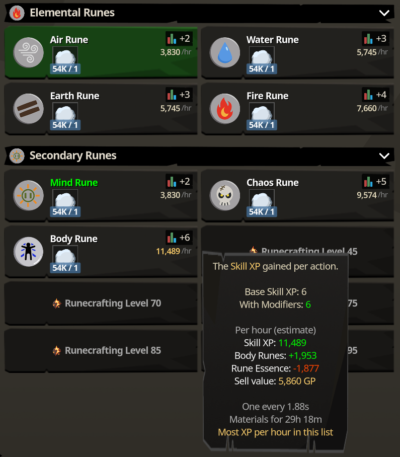

<h1 align="center"></h1>

<a href="../../README.md">All mods</a> · <a href="https://github.com/Springs-Tea/melvor-2-mods/releases">Download</a>

> Which recipe gives more XP per hour: the one that takes 60 seconds for 10 XP, or the one that takes 20 for 3?

## What it shows

| Where | You see |
| --- | --- |
| **In the recipe list** | Every recipe's XP per hour, right under its XP tag. The best one in the list is gold. |
| **In the XP tooltip** | The whole hour: XP, the items made, the items used, what the products sell for, how long one takes, and how long the materials in your bank will last. |

Works for Smithing, Crafting, Fletching, Runecrafting, Beastcrafting, Cooking, Firemaking and Herblore.

## How the numbers are worked out

They come from the game's own values for the recipe, which already contain every bonus you have (equipment,
potions, mastery). On top of those, chances count as their long-run average.

| Skill | One "reward" takes |
| --- | --- |
| Smithing, Crafting, Fletching, Runecrafting, Beastcrafting | steps × interval, less the chance to skip a step |
| Herblore | bottling interval, plus a share of preparing, heating and stirring (they happen once per batch of bottles) |
| Cooking | the interval; a failed attempt takes the time and the ingredients but gives nothing |
| Firemaking | the interval |

Doubling chance is added to the products; preservation chance is taken off the ingredients.

## Good to know

- It is an estimate, not a promise: chances average out over many actions, not over ten.
- Cooking assumes a failed attempt gives neither XP nor food.
- The "materials last" line counts what is in the bank now.

## Install

1. Install the [Melvor Mod Loader](https://www.nexusmods.com/melvoridle2/mods/2).
2. Extract the mod's zip into the game folder, so the file ends up as `mods\RecipeRates\RecipeRates.dll`.

To remove it, delete `mods\RecipeRates`. Your save is never changed.
