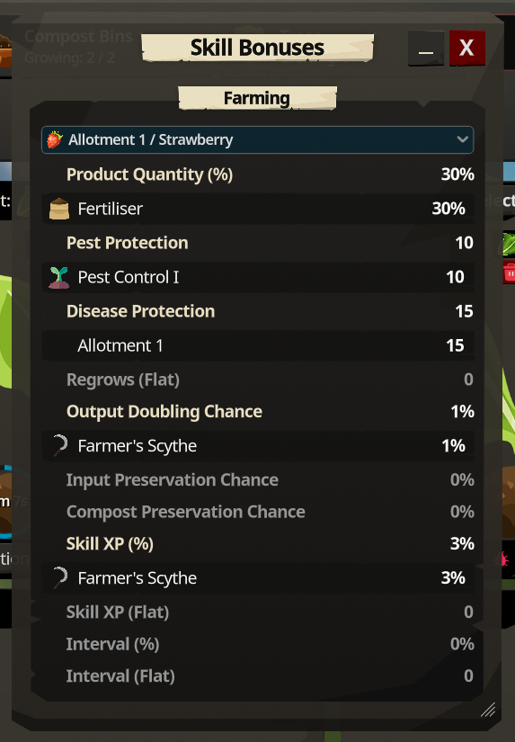

<h1 align="center"></h1>

  
  &nbsp;
  

> Why is my Woodcutting this fast?

A skill page shows the totals of its bonuses: the chance to double, to keep materials, the XP, the action
time. This mod shows where each of them comes from: the item, the pet, the shop purchase, the constellation
and every other source the game counts, with what each one gives.

## Where it is

On a skill page with a stats panel (the one with the chance to double, the XP and the action time), a round
button joins the others on the right edge of the screen. Click it to open the window, and again, or the X, to
close it. Combat has no such panel, and no button.

While it is open, the window follows you from skill to skill. On a page without bonuses (the bank, the shop,
combat) it steps aside, and it is back on the next skill page.

## What the window shows

- **The skill** on the paper strip on top, and under it **what the numbers are for**: the recipe the page is
  showing, or a drop-down where a page has many (trees, rocks, thieving targets, farm plots). On Woodcutting,
  Mining and Thieving it opens on the one your character is cutting, mining or stealing from; pick another to
  compare.
- **Every stat of the page's stats panel**, in the panel's order, with its picture and its total as the page
  writes it.
- **Under each stat, every source of it**, the largest first, with the game's own picture of it where the game
  has one, and what it gives. A stat that nothing adds to is greyed out.
- **Other**, under a total that the listed sources do not add up to at the page's precision: part of it has no
  source the game names. The window says so instead of making up the rest.

## Where the numbers come from

From the game itself: the window reads the same stats the page's panel shows, and the list of sources the game
keeps with each of them. Every value is written by the game's own stat row, so the units and the rounding are
the page's.

- What one source gives a stat in several parts is one line, and so are sources of the same kind and name.
- A source that adds nothing at the moment is left out.
- On Woodcutting, Mining, Thieving and Farming the game keeps a card's stats in the tooltip of its stats icon.
  The window reads them without that tooltip ever being opened.

## Good to know

- The window only reads. Nothing is bought, worn, selected, started or stopped from it, and a click on the
  window or on its button never reaches the game's cards under it.
- The numbers are refreshed twice a second while the window is open.
- It shows the bonuses your character has. Bonuses you could still get (an item to wear, an upgrade to buy)
  are not in this version: which of them would count for which stat is decided inside the game, and the mod
  would have to guess.

## Window controls

Drag the window by any empty spot to move it, and drag its bottom right corner to resize it. The button beside
the X folds it down to its title, to put it aside without closing it. It is as high as what it holds, never
higher than the screen above the game's bar along the bottom: a longer list scrolls. Where it is, its size and
whether it is folded are kept in `settings.json` in the mod's folder.

## When something is off

| You see | What it means |
| --- | --- |
| No round button on a skill page | The page has no stats panel the mod can read. If a page that has one never gets the button, look for `[SkillBonuses]` in `MelvorModLoader.log` and report it. |
| "The game has not filled in these stats yet" | A game update changed the cards' stats panels. Rest the pointer on the card's stats icon once, and the window reads them from there. The log says what went wrong. |
| The button and the window are gone | Look for `[SkillBonuses] Stopped` in `MelvorModLoader.log`: a game update changed something the mod reads. The game and your other mods keep running. |
| A total differs from the page | Report it with a screenshot of both. |

## Install

Get the zip from <a href="https://github.com/Springs-Tea/melvor-idle-2-qol-mods/releases">Releases</a>.

1. Install the [Melvor Mod Loader](https://www.nexusmods.com/melvoridle2/mods/2) (0.1.3 or newer).
2. Open the game folder: Steam > right-click Melvor Idle 2 > Manage > Browse local files.
3. Extract the mod's zip there, so the file ends up as `mods\SkillBonuses\SkillBonuses.dll`.
4. Start the game. `MelvorModLoader.log` in the game folder has a line `Mod loaded: SkillBonuses`.

To update, extract the new zip over the old one. To remove the mod, delete `mods\SkillBonuses`.
Your save is never changed.
