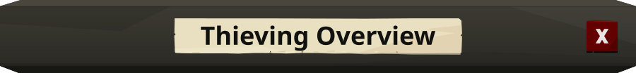
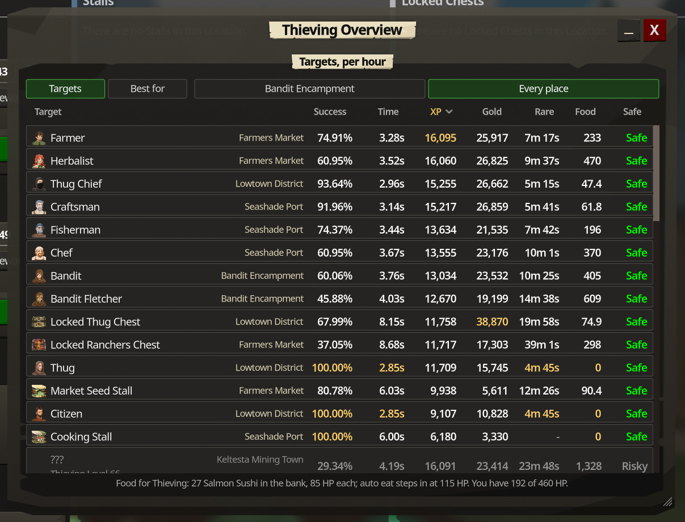
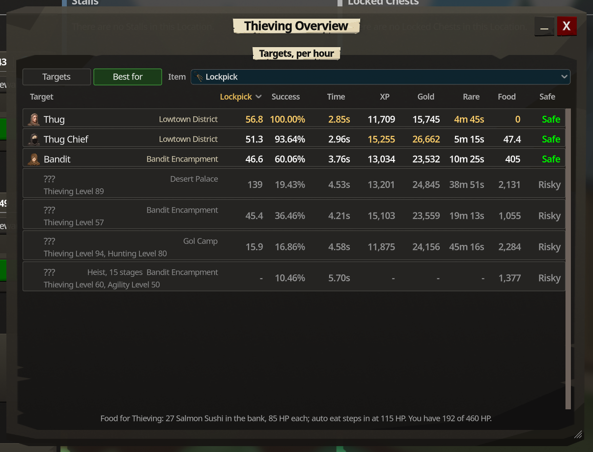

<h1 align="center"></h1>

  
  &nbsp;
  

> Which target should I steal from, for XP, for gold or for one item, and will it knock me out?

Thieving has many targets in many places, each with its own perception, time, damage and loot. The Thieving
page shows the success chance and the XP of one try, for the place it shows. To choose, you would open every
place and every View Possible Rewards and work out the hour in your head. Thieving Overview puts every target
of every place you have found in one list, with what an hour of stealing there gives your character and
whether a failure can knock you out, from the game's own numbers. Click a line to go to that target's place.

## Contents

- [Where it is](#where-it-is)
- [What the window shows](#what-the-window-shows)
- [Best for an item](#best-for-an-item)
- [The tooltip of a line](#the-tooltip-of-a-line)
- [On the game's own screens](#on-the-games-own-screens)
- [What is counted](#what-is-counted)
- [Questions it answers](#questions-it-answers)
- [Good to know](#good-to-know)
- [When something is off](#when-something-is-off)

## Where it is

On the Thieving page, a round button with the Thieving icon joins the others on the right edge of the screen.
Click it to open the window, and again, or the red X, to close it. On a window folded down to its title, the
button opens it up again. It is lit while the window is open and not folded.

The button is only there on the Thieving page. On any other page the window steps aside; back on the Thieving
page, it is there again as you left it, open or folded.

Drag the window to move it, drag its bottom right corner to resize it, or fold it down to its title with the
button beside the X. It is never larger than fits above the game's bottom bar, and a long list scrolls. Its
place, size, fold, choices and sort orders are kept in `settings.json` in the mod's folder.

## What the window shows

At the top, **Targets** lists the targets and **Best for** finds the targets that give an item (see
[Best for an item](#best-for-an-item)). Under Targets, the first button is named after the place the Thieving
page shows and lists its targets; **Every place** lists every target of every place you have found, with the
place after each target's name.

One line per target: its picture, its name, `Heist, 15 stages` for a heist, and per hour of stealing there,
with your character as it is now:

| Column | What it is |
| --- | --- |
| **Success** | The chance that one try succeeds, the game's own and written as the Thieving page writes it: your stealth against the target's perception, with every bonus and distraction. |
| **Time** | Seconds per try: the try itself and, on average, the stun after a failure. |
| **XP** | Thieving XP per hour. |
| **Gold** | Coins plus what the items sell for, per hour. |
| **Rare** | How long until a rare item, on average: `2h 10m` is one rare item every two hours and ten minutes. |
| **Food** | About this much food per hour, with the food chosen for Thieving (see [What is counted](#what-is-counted)). |
| **Safe** | **Safe**, in the game's green: no failure can take you from the point where auto eat steps in to 0 HP. **Risky**, in red: one can. As the Combat Simulator's Safe column says for a fight. |

- **The best number of each column is gold**, when the targets do not all have the same one: the highest
  success, XP and gold, the shortest time, the soonest rare item, the least food. The other numbers are white.
- **Click a column's name to sort by it.** The first click puts the best targets on top, the next turns the
  order around. "Target" sorts by name. The name the list is sorted by is gold, with the game's small arrow
  after it. Targets and Best for each keep their own order.
- **The target you are stealing from** has the lit outline of a selected line, so it can be found in a sorted
  list.
- **Click a line to go to that target's place**: the Thieving page opens that place, as its own Select
  Location does when you pick it there. Thieving is not started or stopped, no target is chosen, and the
  window stays open. The pointer turns into a hand over a line a click takes somewhere; a line of the place
  the page shows, or of a place you cannot open yet, does nothing.
- **A target you cannot steal from yet is greyed**, with what it still needs under its name, in the game's own
  words, each skill once at the level it needs. Like the game's own Thieving cards, a target the game shows as
  `???` is `???` here too, without its picture and without what it gives; what it still needs stays on its
  line. Locked targets come after the others and are never marked best.
- Places and targets the game has not shown you yet are not listed.
- Under the list: the food chosen for Thieving, how many you have in the bank, where auto eat steps in, and
  your HP.

A column's name says, under the pointer, when it shows `-`:

- **XP**, **Gold** and **Rare** for a heist, and **Gold** and **Rare** where the items are not counted (the
  line's tooltip says why); **Rare** also for a target with no rare rewards.
- **Food** without food chosen for Thieving, or with food that heals nothing.
- **Safe** when where auto eat steps in cannot be told.
- Every number but Safe until the game's success chance has been seen as a percent on the Thieving page; a
  line under the list says so while it lasts. Choose a place on the Thieving page.

A target that never fails, does no damage, or whose damage you always avoid is Safe. Without food chosen for
Thieving, without that food in the bank, or without auto eat, every target that can hit you is Risky.

## Best for an item

Press **Best for** and choose an item: a key half, a ring, any item a target you have found can give. The list
shows only the targets that give it, the most per hour first, in a column named after the item, with all the
other columns beside it. It looks at every place, whichever place the Thieving page shows. Under one an hour,
the item's column writes the time between two, as `4h 10m`. A heist that gives the item is listed with `-`,
since a heist's rewards are not counted, and a `???` target that gives it is listed as `???`.

## The tooltip of a line

Put the pointer on a line for the whole hour at that target:

| Line | What it is |
| --- | --- |
| **Farmer · Farmers Market · NPCs** | The target, its place and its kind; for a heist, its stages. |
| **Locked: ...** | What the target still needs. Only on a locked target. |
| **The target you are stealing from.** | Only on the line with the lit outline. |
| **74.91% success · 2.85s a try, 1.80s stunned after a failure** | The game's success chance and time of one try, and the stun after a failure, with the share of it you avoid. |
| **Per hour: 1,098 tries, 822 successful** | The tries an hour holds, and how many of them succeed. |
| **Thieving XP**, **Gold Pieces** | XP and coins per hour. |
| **Potatoes: 111 per hour · 222 gold** | Every common and rare item, with how many an hour brings (`one every 1h 37m` under one), `(rare)` for a rare one, and what they sell for. Not on a `???` target. |
| **When the heist is done: ...** | For a heist, what completing it gives, named but not counted. |
| **Gold: 25,917 (12,953 coins + 12,964 loot)** | Gold in all, split into coins and what the items sell for. |
| **Rare item: 8.22 per hour** | How many tries an hour give a rare item. |
| **Not counted: ...** | Why the items are not counted, when they are not. |
| **Failures: 275 per hour, up to 72 damage each** | The failures of an hour and the most damage one does, with the share of it you avoid. |
| **Food: about 233 Salmon Sushi per hour; your 27 last about 6m 56s** | The food eaten, and about how long what is in your bank lasts at that pace. |
| **Safe: ...** or **Risky: ...** | Why: the biggest hit against your auto eat point, or that auto eat cannot heal you. |
| **Your record here** | The game's own statistics of this target: successful and failed tries, damage taken. |
| **Best of this list: XP** | Which of its numbers are gold. |
| **Click to open Farmers Market on the Thieving page. Thieving is not started.** | What a click on the line does. Not there when a click changes nothing: on a target of the place the page shows, and of a place you cannot open yet. |

## On the game's own screens

- **View Possible Rewards**: rest the pointer on the quantity of a reward (`4 - 8`, `1`), or on the coins'
  `9 - 57`, for how many of it that target gives per hour at your numbers, on the game's own tooltip panel:
  `Steel Arrows: 155 per hour from Bandit, at your numbers now`, or under one an hour `one every 2h 19m`, with
  your chance to double counted when you have one. Every reward has it, common and rare, and nothing is
  written on the window itself: it has no room beside its chances, and the chances keep the tooltip
  [Item Sources](../ItemSources) gives them. A heist's rewards have none, since they are not counted.
- **The Risky tag**: while you are stealing from a target that is Risky, its card on the Thieving page has a
  small tag after the target's name, **Risky** can knock you out. Its tooltip says why: the biggest hit, the
  one the HP bar marks, against your auto eat point, or that auto eat cannot heal you. It goes as soon as the
  target is Safe or you stop. It is on the target's card because the row of the HP bar has no free room; while
  the Thieving page shows another place, the card and its tag are not on the screen. Where the tag would cover
  something of the card's, it is left out, and `MelvorModLoader.log` says so once.

## What is counted

The numbers start from the game's own values for each target, the ones the Thieving page shows: they already
contain your level, stealth and perception, equipment, distractions and every other bonus, so the list moves
with them. Chances count as their long-run average.

- A try takes the game's interval. A failure adds the game's stun after it, unless the chance to avoid the
  stun comes up.
- XP is counted for each successful try: the XP the Thieving page shows for one.
- Coins are counted at the game's chance per successful try, the average of the least and the most it says.
  Items are counted at the common and the rare rewards' chances per successful try, each item at its share of
  its table and the average of its quantities. The chance to double is counted as doubling the items of a try;
  it is not counted for coins.
- When the game counts a fortune for a target, the items are counted as View Possible Rewards shows them with
  that fortune. Until you have opened that target's View Possible Rewards once, its items and gold show `-`.
- Heists: a heist gives its XP and rewards over its stages and on completing them, and how many tries a whole
  heist takes is not a number the game gives. So for a heist only Success, Time, Food and Safe are shown.
- Damage: the most a failure can do is the target's max hit, as the Thieving page shows it; for the target you
  are stealing from, the max hit the HP bar marks. The game does not say how its hits are spread below that,
  so **Food** counts every failure that hurts at the biggest hit, less the chance to avoid the damage and the
  chance to keep the food, divided by what one piece heals. Smaller hits make you eat less; food that heals
  more than you lost, and HP coming back by itself, are not counted. So Food and "lasts" are a guide, not an
  exact count.
- Gold counts coins and what the items sell for, in gold pieces.

## Questions it answers

- **Where do I train Thieving?** The gold number under XP.
- **Where is the gold?** Sort by Gold.
- **Where do I get a Lockpick, a key half, a ring?** Best for, and the item.
- **Can this target knock me out?** The Safe column; and while you steal from it, the Risky tag on its card.
- **How long will my food last here?** The Food line of that target's tooltip.

## Good to know

- It is an estimate, not a promise. Chances average out over many tries, not over ten.
- The game's chance to pickpocket the same area again is not counted.
- Melvor Idle 2 gives no mastery XP per try (its mastery is the Mastery Guild's tasks), so there is no such
  column.
- The window starts nothing. A click on a line only changes which place the Thieving page shows; it never
  starts, stops or chooses a target, buys a distraction, or eats.

## When something is off

| You see | What it means |
| --- | --- |
| No round button on the Thieving page | It comes a moment after the page opens. If it never comes, look for `[ThievingOverview]` in `MelvorModLoader.log`: "the widget strip was not found" means a game update changed the screen. |
| Whole columns show `-` | The line under the list says why. Choose a place on the Thieving page; for coins and items, open a View Possible Rewards once. |
| `-` in a line | A heist (XP, Gold and Rare), items that are not counted (the line's tooltip says why), a target with no rare rewards (Rare), or no food chosen for Thieving (Food). |
| No tooltip on the quantities in View Possible Rewards | A heist's rewards have none. Otherwise `MelvorModLoader.log` says why: a table whose chances the mod could not read, or a game update. |
| No Risky tag while you steal from a Risky target | Its card is not on the screen while the page shows another place, or the tag would cover something of the card's: `MelvorModLoader.log` says so once. |
| A number and the Thieving page disagree | Include the target's name and a picture of both when reporting it. |
| No button and no window at all | Look for `[ThievingOverview] Stopped` in `MelvorModLoader.log`: the mod switched itself off after a game update. The line names where; please include it when reporting. |

## Install

Get the zip from <a href="https://github.com/Springs-Tea/melvor-idle-2-qol-mods/releases">Releases</a>.

1. Install the [Melvor Mod Loader](https://www.nexusmods.com/melvoridle2/mods/2) (0.1.3 or newer).
2. Open the game folder: Steam > right-click Melvor Idle 2 > Manage > Browse local files.
3. Extract the mod's zip there, so the file ends up as `mods\ThievingOverview\ThievingOverview.dll`.
4. Start the game. `MelvorModLoader.log` in the game folder has a line `Mod loaded: ThievingOverview`.

To update, extract the new zip over the old one. To remove the mod, delete `mods\ThievingOverview`.
Your save is never changed.
